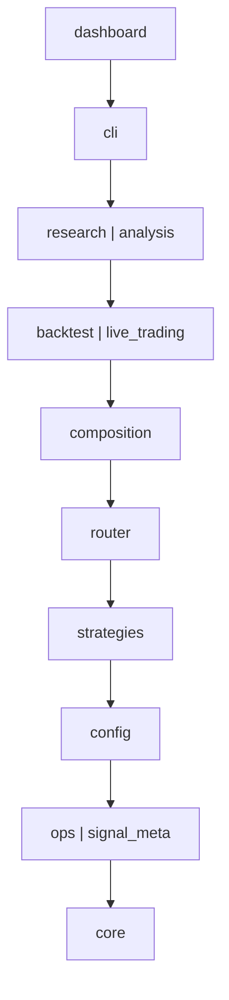

# 架构清单（自动生成）

> 本页由 `python scripts/architecture_inventory.py --write` 从代码生成，CI 用 `--check` 保证它与代码一致，**不要手工编辑**。
> 分层顺序来自 `pyproject.toml` 的 import-linter 契约（规则说明见[架构边界](architecture_review.md)），
> 模块数为 Git 已跟踪的 `.py` 文件数（不含 `__init__.py`）。它不维护项目阶段、任务状态或实盘准入。
> `架构图/` 里的交付图是早期版本的快照，路径变化见 `架构图/path_moves.json`。

## 分层（从高到低；高层可导入低层，反之不行；`|` 两侧互相独立）

## 包与模块数

| 包 | 模块数 | 子包（模块数） |
|---|---|---|
| `cli` | 3 | 平铺 3 |
| `core` | 106 | `analytics` 7, `broker` 6, `events` 5, `exchange` 5, `factors` 6, `foundation` 10, `live_broker` 6, `market` 17, `metrics` 5, `planning` 7, `risk` 10, `trading` 22 |
| `ops` | 14 | 平铺 11；`operations` 3 |
| `signal_meta` | 17 | 平铺 17 |
| `config` | 1 | 平铺 1 |
| `strategies` | 7 | 平铺 7 |
| `router` | 1 | 平铺 1 |
| `composition` | 1 | 平铺 1 |
| `backtest` | 24 | 平铺 12；`reporting` 12 |
| `live_trading` | 9 | 平铺 9 |
| `analysis` | 22 | 平铺 22 |
| `research` | 24 | 平铺 1；`audit` 2, `ml_selection` 21 |
| `dashboard` | 14 | 平铺 14 |

顶层入口文件：`main.py`、`resolve_live_order.py`、`run_live.py`。
