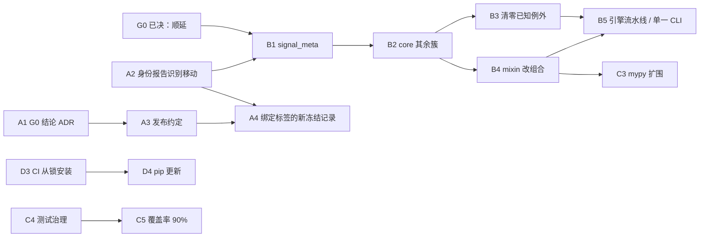

# 基础设施路线图（2026-10 起）

> 核对日期：2026-10-12，依据 `main` 的 `176e90c`（#69）及实测数据（G0 的结论已写入 ADR 0008）；第 4 节末尾的"当前状态"和第 9 节"交接说明"记录了这一天的进度和未决问题。本文是**工程路线图**：排列基础设施与结构整理的顺序、依赖和退出条件。它不维护项目阶段（R0–R8）、任务状态或实盘准入，这些仍以[统一 Roadmap](unified_roadmap.md)为准；它也不改变任何策略研究结论。与之配套：[V4 架构设计（草案）](v4_architecture_design.md)、[架构决策记录](adr/README.md)、[质量门槛](quality.md)、[身份说明](identity.md)。本文取代[工程结构优化路线图](engineering_structure_roadmap.md)中仍然适用的部分。

## 1. 目标与原则

目标：在不改变交易语义的前提下，让项目**可持续**（谁都能安全地改）、**可扩展**（新增策略/选币/回测功能有清晰落点）、**健壮**（回退会被机器拦下）、**可复现**（身份、数据和环境可核验）。

沿用已在执行的原则：

1. 每个 PR 只改变一种东西：搬迁、行为、依赖、文档分开评审。
2. 先建护栏、再动结构；护栏的门槛必须先**实测**，不拍脑袋。
3. 不改写、不放宽任何已有的冻结校验；新方案与旧方案并存，直到有单独的决定取代。
4. 搬迁前先出依赖图（含函数内延迟导入），按实测而不是印象决定边界。
5. 能自动化的规则就写成检查（CI / 测试），不靠记忆。

## 2. 基线：已经完成的

| 编号 | 内容 | 状态 | 依据 |
|---|---|---|---|
| 0.1 | `.gitignore`/`.gitattributes` 修正，PR 模板、CODEOWNERS、SECURITY、CONTRIBUTING、Dependabot（仅 Actions） | 已完成 | #54 |
| 0.2 | 可编辑安装、控制台入口、删除 71 个文件的 `sys.path` 补丁、`install-smoke`（Linux/Windows × 3.11/3.13，已设为必需检查） | 已完成 | #60 |
| 0.3 | ruff/mypy 棘轮（621/869 冻结；B4 之后 mypy 降到 404）、覆盖率门槛 55%→85%、`-n 4` 并行、`slow` 标记、600 秒超时 | 已完成 | #65 |
| 0.4 | import-linter 分层规则，消除 `core → research`，4 条已知例外只减不增 | 已完成 | #66 |
| 0.5 | 行为身份 `code-token/v1`、PR 影响报告、文档移动索引、断链检查 | 已完成 | #64 |
| 0.6 | `dev.py check`、ADR 0001–0006、dev container（未实际运行）、脚本索引补全 | 已完成 | #67 |
| — | 交付 ZIP 迁到 GitHub Release；文档整理（160→约 140 个 Markdown）；分支保护、密钥扫描、Dependabot alerts | 已完成 | #62、#52/#59、仓库设置 |
| V4.0-1 | 12 个运维/治理模块移到顶层包 `ops/`（ADR 0007） | 已完成 | #68 |
| — | 本路线图 | 已完成 | #69 |
| A1 | G0 的结论：前向观察窗顺延，整理后重新登记（ADR 0008） | 已完成 | 本 PR |
| A2 | `identity_report.py` 识别移动与仅导入路径变化；用 #68 实测为"移动 15 个文件、4 个仅导入变化" | 已完成 | 本 PR |
| A3 | 发布约定：语义化版本、`CHANGELOG.md`、`release_check.py`、`pyproject` 版本 3.0.0（ADR 0009）。**标签 `v3.0.0` 尚未创建**，合并后由仓库所有者打 | 已完成（标签待打） | 本 PR |
| B1 | 14 个信号元层模块（约 3500 行）移到顶层包 `signal_meta/`（ADR 0011）；回放指纹键保持旧名并有测试；身份报告：移动 14 个、仅导入变化 5 个 | 已完成 | #72、#74 |
| B2-1 | `core/market/`：17 个行情与时间/标的模块（ADR 0012）；`request_budget` 的仓库根路径修正并有测试 | 已完成 | #72、#73、#74 |
| B2-2 | `core/trading/`：20 个订单、保护单、账户与状态存储模块（ADR 0013） | 已完成 | #74 |
| B2-3 | `core/planning/`：7 个选币、打分、分配与目标仓位模块；`portfolio`、`valuation` 并入 `core/trading/`（ADR 0014） | 已完成 | #75 |
| B2-4 | `core/analytics/`：7 个审计、诊断、健康与指标模块（ADR 0015） | 已完成 | #76 |
| B2-5 | `core/foundation/`：10 个基础件模块（ADR 0016）；B2 完成，`core/` 平铺模块 78 → 0 | 已完成 | #77 |
| B3 | 分层规则清零 4 条已知例外：标签对账三个模块搬到 `signal_meta/`，`create_selector`/`restore_selector` 搬到 `research/ml_selection/serving.py`；`ignore_imports` 删除，测试收紧（ADR 0017） | 已完成 | #78 |
| B4 | 4 个宿主类的 13 个 mixin 改为持有 `host` 引用的协作类（ADR 0018）；mypy 869 → 404（`attr-defined` 475 → 49）；状态所有权迁移、报告与策略 mixin 未做 | 已完成（第一步） | 本 PR |
| A4 | 绑定记录 `release-bound-identity/v1`、`--bind-release/--verify-binding`（ADR 0010）；旧记录不动。真正的新身份登记留到整理完成后 | 已完成 | 本 PR |

当前规模（`main`，2026-10-12）：`core/` 78 个平铺模块 + 7 个子包；246 个测试文件、约 3945 个测试，CI 并行约 3 分钟；覆盖率 89.1%；ruff 621、mypy 869 项存量；`BacktestEngine.run` 所在文件 1296 行，`main.py` 1126 行；4 个宿主类共 13 个 mixin（`Broker` 4、`LiveBroker` 3、`RiskManager` 3、`LiveTradingEngine` 3，约 6300 行，每个 mixin 共享 10–60 个 `self` 属性；另有报告 4 个、策略 3 个 mixin 不在 B4 范围）；`scripts/` 97 个脚本；0 个发布标签。

## 3. 先决问题（阻塞项）

### G0 前向观察窗与源码身份（已决：顺延，见 [ADR 0008](adr/0008-defer-forward-observation-window.md)）
文档记载的前向观察窗为 **[2026-10-21, 2027-04-19)**（见[统一 Roadmap](unified_roadmap.md) 第 6 节），绑定的是 `followup-successor-03` 登记的源码清单（`code_hash = 1ed2cf91…`，395 个文件的字节哈希；协议尚未打开任何样本）。2026-10-12 的实测显示它已不对应 `main`：626 个文件中 536 个不同（新增 241、删除 10、修改 285），`config/params.yaml` 的哈希也不再等于冻结的 `config_hash`（2026-10-04 的 `ca78e9c` 新增了默认关闭的 `capital:` 配置块）。

**结论：观察窗顺延。** 旧协议与回执保留为历史记录，不改写；结构整理（轨道 B）先于新身份登记进行；整理完成后先说明 `capital:` 配置变更并另写协议，再登记新身份，新窗口和成熟日从登记时间重新计算。登记前须具备 A3、A4。登记之后，冻结范围重新受约束：观察期内改动走重新登记流程。

## 4. 轨道与里程碑

编号 `A/B/C/D` 为轨道，`M` 表示里程碑；规模 S/M/L 指预计 PR 数量级（1 / 2–3 / 4+），不是日期。

### 轨道 A：身份与发布
目的：让"这个版本是什么"有一个可核验、与整理无关的答案。

| 编号 | 工作 | 规模 | 依赖 | 退出条件 |
|---|---|---|---|---|
| A1 | 弄清并记录 G0 的结论；写成 ADR（已写 ADR 0008） | S | — | ADR 说明观察窗绑定的身份及改动流程 |
| A2 | `identity_report.py` 识别重命名/仅导入路径变化的移动（按"去掉导入语句后的 token 流"比较） | S | — | 搬迁 PR 的报告显示"移动 N 个文件，行为不变"，不再是删增 |
| A3 | 发布约定：语义化版本、`CHANGELOG.md`、标签规则；首个标签（约定已完成，标签待所有者创建） | S | A1 | 有标签；`python scripts/identity_report.py` 可用标签作为 `--base` |
| A4 | 新的冻结记录改绑"标签 + 行为身份回执"（ADR 取代 0003 的未决部分）；旧记录不动 | M | A2、A3 | 新登记流程文档与测试；旧验证不变 |

### 轨道 B：结构（V4.0 的延续）
每步沿用同一流程：依赖图 → 方案 → 搬迁（无垫片）→ 身份报告 → 全量测试。**G0 已决为顺延观察窗：新身份登记之前不受冻结约束，须在登记（A4 之后）前完成。**

| 编号 | 工作 | 规模 | 依赖 | 退出条件 |
|---|---|---|---|---|
| B1 | `signal_meta/`：12 个 `signal_*` + `temporal_labels` + `temporal_financing`（14 个模块，约 3500 行，导入点约 61 处）；回放指纹键保持旧名 | M | A2 | 与 `ops` 并列的新层；导入规则通过；指纹不变（有测试） |
| B2 | 其余 `core` 簇按实测依赖图逐个评估：数据/适配（`data_fetcher`、`market_data`、`websocket_market` …）、执行（`broker`、`live_broker`、`exchange`）、指标（`metrics` 1746 行、`diagnostics`）、选币/分配 | L | B1 | `core/` 平铺模块 78 → 0；每簇一个 PR、一条 ADR |
| B3 | 清零 4 条已知例外：`backtest.engine → signal_meta.label_account_reconciliation`、`backtest.coin_selector → research.ml_selection.*`（随 V4 选币器统一） | M | B2 | `ignore_imports` 为空，测试同步收紧 |
| B4 | mixin 改组合：`LiveBroker`（提交/对账/账户同步）、`LiveTradingEngine`、`Broker`、`RiskManager`；每次先固定订单/成交/恢复/状态写入的行为再替换 | L | B2 | 4 个宿主类的 13 个 mixin → 0（规模 2026-10-13 实测：约 6300 行，需按 mixin 逐个、每个一个 PR）；mypy 的 475 项 `attr-defined` 自然消失 |
| B5 | `BacktestEngine.run`（约 840 行）流水线化；`main.py` 瘦身为单一 CLI；`scripts/` 97 个脚本分类，一次性研究脚本迁出主线 | L | B3、B4 | 每阶段 < 100 行；`main.py` < 200 行 |

### 轨道 C：质量债务
目的：把"冻结的存量"变成"逐步清零"。

| 编号 | 工作 | 规模 | 依赖 | 退出条件 |
|---|---|---|---|---|
| C1 | 还债策略：每个 PR 在触碰的文件里顺手减少存量（`quality_ratchet.py update`）；按规则逐个清零后升为硬门槛（先 `F401/F811/F841/E4/E7`，再 `B`） | 持续 | — | 约定写入 CONTRIBUTING；每个季度回看基线总数 |
| C2 | 复核棘轮扫描出的可疑模式并逐个给出结论（修复或注明无害）：B023（`core/market/binance_depth_observer.py` 8 处等）、`core/broker/financing.py` 的 `seconds_per_year`、B904 | M | — | 每项有 issue 或 ADR 结论；涉及资金计提的先写失败样本再改 |
| C3 | mypy 扩围：随 B4 清掉 mixin 错误后，把已达标模块纳入硬门槛清单 | 持续 | B4 | 硬门槛文件数增长；基线下降 |
| C4 | 测试治理：在 Windows 上为符号链接测试加跳过条件；不稳定测试的处理约定（定位、隔离标记、期限）；耗时预算（完整套件 ≤ 5 分钟） | S | — | 本地 Windows 全绿；约定写入 `docs/quality.md` |
| C5 | 覆盖率：85% → 90%，并评估分支覆盖 | S | C4 | 门槛上调且 CI 通过 |

### 轨道 D：仓库、数据与环境
| 编号 | 工作 | 规模 | 依赖 | 退出条件 |
|---|---|---|---|---|
| D1 | 分支与 worktree 清理：42 个已合并远端分支、3 个 Dependabot 旧分支、`old-origin` 的 3 个分支、10 个 worktree（4 个已失效）；3 个未合并分支逐个决定（其中两个有不在 `main` 上的 8 月提交：本地 `docs/readme-architecture-and-local-data` 的 `80b6833`、远端 `docs/readme-glossary-update` 的 `29f3a71`，先与 `main` 对比再定，第三个是 `claude/canonical-trading-events-*`）。**先列清单，经确认后执行**（不可逆） | S | 你的确认 | 远端只保留 `main` 与进行中的分支 |
| D2 | **数据身份**（旧路线图阶段 2，仍未完成）：`data/binance/1d/_manifest.json` 只记录 2 个标的，已跟踪 CSV 共 30 个；分离"下载缓存清单"与"冻结研究输入清单"，为每个采用的文件登记来源、范围、行数、SHA-256；无法证实的标"未核验" | M | — | 冻结清单覆盖全部被采用的输入；缺失/替换使校验失败 |
| D3 | **环境收敛**（旧路线图阶段 3，仍未完成）：CI 目前从 `requirements-dev.txt` 安装（只固定直接依赖），锁文件仅被校验；做"锁文件再生成脚本"，让 CI 从锁安装并严格比对；之后才启用 Dependabot 的 pip 与安全更新 | M | — | CI 在锁定环境运行；`verify_lock` 与 `check_environment --strict-lock` 都在 CI 中 |
| D4 | Dependabot 策略：频率改为每月或分组；主版本升级的评审约定 | S | — | `dependabot.yml` 更新；噪音可控 |
| D5 | 静态分析：评估启用 CodeQL；dev container 实际验证；`install-smoke` 稳定后评估是否纳入更多平台 | S | — | 各项有"启用 / 不启用 + 理由" |
| D6 | 生成物与文档：架构图（`架构图/`，路径仍是旧的）由脚本从 `core`/`ops` 现状重新生成并加入检查；文档数量与 `doc_index.json` 的维护约定 | S | B1 | 架构图与代码一致且有检查 |

### 当前状态（2026-10-12）

| 编号 | 状态 | 备注 |
|---|---|---|
| G0 | **已决：顺延** | ADR 0008；旧身份与 `main` 已相差 536 个文件且配置已变；整理后重新登记 |
| A1–A4 | 已完成（本 PR 合并后生效） | 唯一遗留：首个标签 `v3.0.0` 要在合并后由仓库所有者创建并推送（见[发布约定](releasing.md) §3），之后可用 `--base v3.0.0`；新身份的登记本身仍在整理完成之后 |
| B1 | 已完成（ADR 0011，已合并 #74） | `temporal_data` 留在 `core`（现为 `core/market/`）；`core/` 平铺模块 78 → 64 |
| B2 | 已完成并合并：`core/market/`、`core/trading/`、`core/planning/`、`core/analytics/`、`core/foundation/`（ADR 0012–0016，#74–#77） | `core/` 平铺模块 63 → 0 |
| B3 | 已完成（ADR 0017，待合并） | 分层契约无例外 |
| B4 | 已完成第一步（ADR 0018，待合并）：mixin 继承清零；状态仍由宿主持有 | mypy 869 → 404 |
| B5 | 未开始（须在新身份登记前完成） | B1 的依赖图分析已做过：14 个模块、约 3500 行、导入点约 61 处，`temporal_data` 必须留在 `core`；`backtest/signal_meta_replay.py` 的指纹键需保持旧名 |
| C1 | 已约定、未写入 CONTRIBUTING | 每个 PR 顺手减少触碰文件的存量 |
| C2–C5 | 未开始 | C2 的可疑模式清单已在 `docs/quality.md` |
| D1 | 待你确认清单 | 清单见上表 D1 行 |
| D2、D3 | 未开始 | 数据清单只登记 2 个标的而已跟踪 CSV 有 30 个；CI 从 `requirements-dev.txt` 安装而不是锁文件 |
| D4–D6 | 未开始 | — |

## 5. 依赖与顺序

A1–A4 已完成后，可以立刻并行的：**C2、C4、D1、D2、D3、D4、D5**，以及 B1（建议先打 `v3.0.0` 标签作为影响报告的基准）。B 轨道须在新身份登记前完成。

建议的"现在 / 接着 / 之后"：

| 阶段 | 内容 |
|---|---|
| **现在** | 打 `v3.0.0` 标签（所有者）、D1（清单确认后执行）、C4、C2 |
| **接着** | D2、D3、D4、B1 |
| **之后** | B2–B5、C3、C5、D5、D6，然后新身份登记（用 A4 的绑定记录，并先说明 `capital:` 配置变更） |

## 6. 进入 V4 功能开发的条件（M1）

下列全部满足后，再开始 V4 设计中的特征管线、回测两层化、选币统一、新策略与 ML 改进（它们的结论是否可信依赖这些底座）：

1. G0 已有结论并写成 ADR（A1，已完成：ADR 0008）；新身份已按 A4 的流程登记。
2. 身份报告能识别移动（A2，已完成），并有发布标签约定且首个标签已创建（A3，约定已完成，标签待打）。
3. 数据身份完整（D2）、CI 在锁定环境运行（D3）。
4. `core/` 已完成至少 `signal_meta/` 的拆分（B1），且无新增的反向依赖。
5. 分支/worktree 已清理（D1），测试治理约定生效（C4）。

M1 之后的功能轨道（特征管线 → 回测两层化 → 选币统一 → 新策略 → ML v2）见[V4 设计](v4_architecture_design.md)第 9 节；它们与轨道 B 的 B2–B5 可以交错，但每一项都要沿用"先护栏、再搬迁、再功能"的顺序。

## 7. 风险与对策

| 风险 | 对策 |
|---|---|
| 结构搬迁破坏冻结候选的可验证性 | G0 已决（顺延观察窗）；新身份登记前完成搬迁，登记后冻结范围不再动；每次搬迁都有身份报告和全量测试 |
| 搬迁引入向上依赖或循环 | import-linter 在 CI 必须通过；例外清单只减不增并有测试固定 |
| 事件/状态的持久化格式被无意改变 | 沿用 ADR 0005：先在未改动代码上写锁定格式的测试 |
| 棘轮基线变成"永久豁免" | C1 的清零约定与季度回看；规则清零后升为硬门槛 |
| 并行测试或新检查带来偶发失败 | C4：偶发失败必须定位或隔离并设期限，不得靠重跑掩盖 |
| 一次性大改动难以评审 | 每个 PR 只含一种变化；搬迁 PR 要有依赖图与影响报告 |
| 清理操作不可逆 | D1 先列清单经确认；不改写 Git 历史（ADR 0006） |

## 8. 维护方式

- 完成一项就把本文第 2 节的表格追加一行（编号、PR、依据），并在第 4 节改状态；不要删除历史行。
- 新决定写成 ADR（`docs/adr/`），本文只引用它。
- 与统一 Roadmap 的关系：本文不改阶段与任务状态；若某项工作需要登记为 SYS 任务，在[开发计划](development_plan.md)里按其规则登记，并在这里引用编号。
- 每个里程碑结束时回看第 3 节（先决问题）与第 7 节（风险）是否仍然成立。

## 9. 交接说明（给下一个维护者或新会话）

**工作方式（已在 #52–#69 中沿用）：**

- 流程：从最新 `origin/main` 拉分支 → 实现并本地跑 `python scripts/dev.py check`（`--no-tests` 跳过长测试）→ 提交 → 推送 → 开 PR → 等 CI。**合并由仓库所有者操作**，AI 助手的合并操作会被权限系统拦下；严格分支保护要求分支是最新的，所以每合并一个，其余 PR 需要先更新分支并重跑 CI。
- 必需检查共 5 项：`quality` 与 `install-smoke`（ubuntu/windows × 3.11/3.13）。Dependabot 只管 GitHub Actions，每周一次，同时最多 3 个 PR。
- 不可逆或对外可见的操作先列清单、经确认再做：删除分支、迁出文件、改仓库设置、发布 Release。
- 提交信息末尾带 `Co-Authored-By` 行，PR 描述末尾带 `Generated with Claude Code` 行（由会话的归属规则给出）。

**机器检查与它们的文档：** `scripts/dev.py list`；[质量门槛](quality.md)（棘轮、覆盖率、标记）；[身份说明](identity.md)（行为身份、`doc_index.json`、断链检查）；[架构边界](architecture_review.md)（分层与已知例外）；[ADR](adr/README.md)。

**已知陷阱：**

- 本地 Windows 上 `tests/test_ml_selection_candidate_dataset.py::test_archived_default_inputs_cannot_escape_via_symlink` 因没有符号链接权限（WinError 1314）而失败，Linux CI 上会通过（C4 计划加跳过条件）。
- 工作区是 CRLF、仓库内容是 LF：读取工作区文件做哈希前要按 git 规则规范化（`core/foundation/source_identity.py` 已处理）；批量改写文本文件时保留原有换行符。
- 在某些 shell 工具里，heredoc 中的反斜杠转义会被改写（出现过 `\0` 变成真正的空字节）。需要写含转义的 Python 时，先把脚本写成文件再运行，或用 `chr(…)` / `bytes([…])` 构造。
- `pip install -e .` 在联网不稳时可能挂起；已装好依赖时用 `--no-deps --no-build-isolation`。给 `pyproject.toml` 增加包后需要重新执行可编辑安装，否则新包导入不到。
- 链接检查只看已被 git 跟踪的文件：新增文档要先 `git add`。
- 冻结的历史证据（`docs/archive/2026-08*`、`2026-09*`、`docs/research/ml_selection_next_acceptance_20261005.json`、`docs/codex_mail_findings_20260920.json`、`docs/research/current_strategy_protocol.json`、`reports/` 回执）不得改写；移动文档要在 `docs/doc_index.json` 追加一条。

**第一件事：** G0 已决（顺延，ADR 0008），A1–A4 已完成；合并后先创建 `v3.0.0` 标签，再按第 5 节"现在"一栏开始（D1、C4、C2）。
