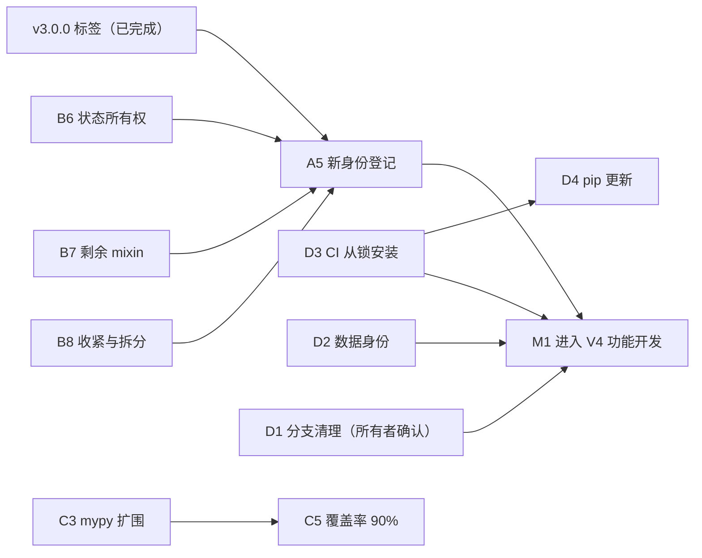

# 基础设施路线图（2026-10 起）

> 核对日期：2026-10-14，依据 `main` 的 `b4f55f7`（#93）及实测数据。第 4 节末尾的"当前状态"、第 5 节"接下来的顺序"和第 9 节"交接说明"记录了这一天的进度、未决问题和本轮得到的教训。本文是**工程路线图**：排列基础设施与结构整理的顺序、依赖和退出条件。它不维护项目阶段（R0–R8）、任务状态或实盘准入，这些仍以[统一 Roadmap](unified_roadmap.md)为准；它也不改变任何策略研究结论。与之配套：[V4 架构设计（草案）](v4_architecture_design.md)、[架构决策记录](adr/README.md)、[质量门槛](quality.md)、[身份说明](identity.md)、[发布约定](releasing.md)。本文取代[工程结构优化路线图](engineering_structure_roadmap.md)中仍然适用的部分。

**一句话状态：轨道 A 除新身份登记外、B 全部（B6 的五片在 PR #95）、C 全部、D 除 D1 外都已做完。还没做的只有两件：分支清理 D1（清单已重新生成，等所有者确认后才执行）、以及新身份登记 A5（依赖已齐：标签已打、B6 已做完）。首个发布标签 `v3.0.0` 已在 2026-10-14 创建并推送（带注解，指向 `619abfa`，即 #94 的合并提交）。24 项里 23 项完成。另有两个数据问题等研究决定（见 D2）。**

## 1. 目标与原则

目标：在不改变交易语义的前提下，让项目**可持续**（谁都能安全地改）、**可扩展**（新增策略/选币/回测功能有清晰落点）、**健壮**（回退会被机器拦下）、**可复现**（身份、数据和环境可核验）。

沿用已在执行的原则：

1. 每个 PR 只改变一种东西：搬迁、行为、依赖、文档分开评审。
2. 先建护栏、再动结构；护栏的门槛必须先**实测**，不拍脑袋。
3. 不改写、不放宽任何已有的冻结校验；新方案与旧方案并存，直到有单独的决定取代。
4. 搬迁前先出依赖图（含函数内延迟导入），按实测而不是印象决定边界。
5. 能自动化的规则就写成检查（CI / 测试），不靠记忆。

## 2. 基线：已经完成的

| 编号 | 内容 | 状态 | 依据 |
|---|---|---|---|
| 0.1 | `.gitignore`/`.gitattributes` 修正，PR 模板、CODEOWNERS、SECURITY、CONTRIBUTING、Dependabot（仅 Actions） | 已完成 | #54 |
| 0.2 | 可编辑安装、控制台入口、删除 71 个文件的 `sys.path` 补丁、`install-smoke`（Linux/Windows × 3.11/3.13，已设为必需检查） | 已完成 | #60 |
| 0.3 | ruff/mypy 棘轮（最初 621/869 冻结；C2 之后降到 588/326）、覆盖率门槛 55%→85%、`-n 4` 并行、`slow` 标记、600 秒超时 | 已完成 | #65 |
| 0.4 | import-linter 分层规则，消除 `core → research` | 已完成 | #66 |
| 0.5 | 行为身份 `code-token/v1`、PR 影响报告、文档移动索引、断链检查 | 已完成 | #64 |
| 0.6 | `dev.py check`、ADR 0001–0006、dev container（#88 起由 CI 构建并运行检查）、脚本索引补全 | 已完成 | #67 |
| — | 交付 ZIP 迁到 GitHub Release；文档整理（160→约 140 个 Markdown）；分支保护、密钥扫描、Dependabot alerts | 已完成 | #62、#52/#59、仓库设置 |
| V4.0-1 | 12 个运维/治理模块移到顶层包 `ops/`（ADR 0007） | 已完成 | #68 |
| — | 本路线图 | 已完成 | #69、#70 |
| A1 | G0 的结论：前向观察窗顺延，整理后重新登记（ADR 0008） | 已完成 | #71 |
| A2 | `identity_report.py` 识别移动与仅导入路径变化；用 #68 实测为"移动 15 个文件、4 个仅导入变化" | 已完成 | #71 |
| A3 | 发布约定：语义化版本、`CHANGELOG.md`、`release_check.py`、`pyproject` 版本 3.0.0（ADR 0009）。标签 `v3.0.0` 已于 2026-10-14 由所有者创建并推送（带注解，指向 `619abfa`，`release_check.py v3.0.0 --verify-tag` 通过） | 已完成 | #71 |
| A4 | 绑定记录 `release-bound-identity/v1`、`--bind-release/--verify-binding`（ADR 0010）；旧记录不动。真正的新身份登记留到整理完成之后 | 已完成 | #71 |
| B1 | 14 个信号元层模块（约 3500 行）移到顶层包 `signal_meta/`（ADR 0011）；回放指纹键保持旧名并有测试 | 已完成 | #74（经 #72、#73） |
| B2-1 | `core/market/`：17 个行情与时间/标的模块（ADR 0012）；`request_budget` 的仓库根路径修正并有测试 | 已完成 | #74 |
| B2-2 | `core/trading/`：20 个订单、保护单、账户与状态存储模块（ADR 0013） | 已完成 | #74 |
| B2-3 | `core/planning/`：7 个选币、打分、分配与目标仓位模块；`portfolio`、`valuation` 并入 `core/trading/`（ADR 0014） | 已完成 | #75 |
| B2-4 | `core/analytics/`：7 个审计、诊断、健康与指标模块（ADR 0015） | 已完成 | #76 |
| B2-5 | `core/foundation/`：10 个基础件模块（ADR 0016）；**持久化事件类型名保持 `core.domain:…`**；`core/` 平铺模块 78 → 0 | 已完成 | #77 |
| B3 | 分层规则清零 4 条已知例外：标签对账三个模块搬到 `signal_meta/`，`create_selector`/`restore_selector` 搬到 `research/ml_selection/serving.py`；`ignore_imports` 删除（ADR 0017） | 已完成 | #78 |
| B4 | 4 个宿主类的 13 个 mixin 改为持有 `host` 引用的协作类（ADR 0018）；mypy 869 → 404；**状态所有权迁移、报告与策略 mixin 未做** | 已完成（第一步） | #79 |
| B5 | `BacktestEngine.run` 与 `main()` 流水线化；入口移到 `cli/`，`main.py` 剩 5 行；`scripts/` 100 个脚本按生命周期分类并有测试，历史脚本因证据哈希绑定**不搬迁**（ADR 0019） | 已完成 | #80 |
| C4 | 测试治理：符号链接测试按能力探测跳过，`quarantine` 标记 + 到期检查，耗时预算与 CI 超时，约定写入 `docs/quality.md` | 已完成 | #81 |
| C2 | 棘轮扫描出的可疑模式逐个复核：借贷年化（`seconds_per_year`）是死代码，先写特征测试再清理；B023 共 29 处无害并显式绑定；B904、mypy `attr-defined` 逐项给出结论，无需改变交易行为。ruff 621 → 588，mypy 365 → 326 | 已完成 | #82 |
| C1 | 还债约定写入 CONTRIBUTING（顺手减少触碰文件的存量、规则清零后升硬门槛、季度回看）；`docs/quality.md` 增加季度记录表 | 已完成 | #85 |
| C3 | mypy 硬门槛清单 `scripts/mypy_hard_gate.txt`（128 个零错误模块），`quality_ratchet.py check` 对其中任何发现直接失败，`promote` 收进新达标的模块（ADR 0022）。持续项：随重构继续清零并扩围 | 已完成（持续项） | #85 |
| C5 | 覆盖率门槛 85% → 90%（行覆盖实测约 90.5%），为一批没有直接测试的运维与恢复工具补了行为测试；分支覆盖实测 79.8%，评估结论是暂不设门槛、按季度记录（ADR 0024） | 已完成 | #85 |
| D2 | 冻结研究输入清单 `data/binance/1d/_frozen_inputs.json` 与 `scripts/data_inputs.py`：30 个已跟踪 CSV 登记行数、范围与 SHA-256（LF 规范化），来源状态如实标注（2 个有下载记录，28 个未核验；之后又用 Binance 公共日线做了独立佐证，见 #92）；CI 与 `dev.py check` 核验（ADR 0020，`docs/data_identity.md`） | 已完成（28 个来源仍未核验） | #85 |
| D3 | `scripts/regenerate_lock.py`（再生成与离线 `--check`）；CI 从 `requirements.lock.txt` 安装并运行 `check_environment.py --strict-lock`、`verify_lock.py`、`regenerate_lock.py --check`；锁文件规范化（无版本变化）（ADR 0021） | 已完成（首次 CI 运行待观察） | #85 |
| D4 | Dependabot：Actions 每月、小版本分组、主版本单独成 PR；pip 版本更新继续不启用并写明原因（ADR 0021） | 已完成 | #85 |
| D5 | CodeQL 启用（不设必需检查）；dev container 保留并改用 `dev.py setup`，本机无 Docker，改由 CI 的 `devcontainer` 工作流构建并运行 `dev.py check`（#88）；不增加 `install-smoke` 平台（ADR 0023） | 已完成（dev container 待有 Docker 的人验证） | #85 |
| D6 | `docs/architecture_inventory.md` 由 `scripts/architecture_inventory.py` 生成并在 CI 核对；交付图 `架构图/` 不改写，`path_moves.json` 记录其引用的 16 个已搬迁路径并被检查；文档维护约定写入 `docs/README.md`（ADR 0023） | 已完成 | #85 |
| B6-2 | 模拟撮合器的 `pending_orders`、`active_orders` 搬进 `Matching`，`risk_action_targets` 搬进 `Liquidation`，`Broker` 用 `Delegated` 保留旧名；金样本测试一字不改通过（ADR 0028） | 已完成（B6 的第二片） | 本 PR |
| B6-3 | `LiveBroker` 的 8 个账户同步状态属性搬进 `AccountSync`（六个“未绑定”属性保持未绑定，探测语义不变），`LiveBroker` 用 `Delegated` 保留旧名；金样本测试一字不改通过（ADR 0029） | 已完成（B6 的第三片） | 本 PR |
| B6-4 | `LiveTradingEngine` 的 7 个对账与导出状态属性搬进 `Recovery`（5）和 `StateExport`（2），`_account_reconciliation_persistence_failed` 保持“未绑定”，引擎用 `Delegated` 保留旧名；金样本测试一字不改通过（ADR 0030） | 已完成（B6 的第四片） | 本 PR |
| B6-5 | `TickOrchestrator` 独占写入的 8 个记账属性（tick 计数、崩溃与退避、策略失败、上次耗时、已告警的健康转换、实际成交风险审计）搬进它自己，引擎用 `Delegated` 保留旧名；与其他写入者共享的引擎级状态不搬；金样本测试一字不改通过（ADR 0031） | 已完成（B6 的第五片，B6 收尾） | 本 PR |
| B7 | 报告生成的 4 个 mixin 改为协作类（`ReportGenerator` 保留全部同签名转发方法），Donchian 策略的 3 个私有 mixin 合成显式基类 `DonchianTrendStrategy`；代码里不再有 `*Mixin` 类；mypy 326 → 313（ADR 0025） | 已完成 | #86 |
| B8 | 引擎与命令行里超过 100 行的 3 个函数拆开（`BacktestEngine.__init__` 149 → 73、`_close_tail_positions` 118 → 66、`replay_manifest` 131 → 43）；`_RunState`（48 个字段）与 `_MainState`（26 个字段）的 `Any` 注解全部换成具体类型，并有结构测试固定（ADR 0026） | 已完成 | #87；函数长度棘轮：#91 |
| D5 收尾 | `devcontainer` 工作流：在 CI 里构建 `.devcontainer/` 并运行 `dev.py check --no-tests`（ADR 0023 后续） | 已完成 | #88 |
| C3 + D2 收尾 | C3：11 处纯注解，硬门槛 129 → 136；D2：`data_inputs.py corroborate` 对 28 个文件做独立佐证，发现 27 个文件最后一根日线未收盘、`MATIC` 多 83 行（ADR 0020 后续） | 已完成 | #92（取代 #89、#90） |
| B6-1 | 熔断器的 13 个状态属性搬进 `CircuitBreaker`，`RiskManager` 用 `Delegated` 描述符保留旧名；先录金样本测试再迁移（ADR 0027） | 已完成（B6 的第一片） | #93 |

当前规模（`main`，2026-10-14）：`core/` 根没有平铺模块，有 12 个子包（`analytics`、`broker`、`events`、`exchange`、`factors`、`foundation`、`live_broker`、`market`、`metrics`、`planning`、`risk`、`trading`）；顶层包新增 `ops/`、`signal_meta/`、`cli/`；4215 个测试、270 个测试文件，本地串行（Windows，未装 xdist）约 5 分钟，CI 并行约 3 分钟；ruff 588、mypy 301；`BacktestEngine.run` 32 行，`main.py` 5 行；`scripts/` 103 个脚本（`supported` 37、`research` 47、`historical` 19）；27 条 ADR（0020–0024 在 #85，0025 在 #86，0026 在 #87，0027 在 #93）；分层契约无例外；0 个发布标签（远端只有证据标签 `evidence-archive-2026-09`）。覆盖率 2026-10-14 在 Windows 本地实测：行 89.54%（补测试前）→ 90.58%（补测试后），分支 79.8%；CI 的 `--cov` 范围是 `core`、`ops`、`signal_meta`、`backtest`、`live_trading`，**不含 `cli`**。

## 3. 先决问题（阻塞项）

### G0 前向观察窗与源码身份（已决：顺延，见 [ADR 0008](adr/0008-defer-forward-observation-window.md)）
文档记载的前向观察窗为 **[2026-10-21, 2027-04-19)**（见[统一 Roadmap](unified_roadmap.md) 第 6 节），绑定的是 `followup-successor-03` 登记的源码清单（`code_hash = 1ed2cf91…`，395 个文件的字节哈希；协议尚未打开任何样本）。2026-10-12 的实测显示它已不对应 `main`（626 个文件中 536 个不同，`config/params.yaml` 的哈希也不再等于冻结的 `config_hash`：2026-10-04 的 `ca78e9c` 新增了默认关闭的 `capital:` 配置块）。此后的结构整理又改动了更多文件。

**结论：观察窗顺延。** 旧协议与回执保留为历史记录，不改写；结构整理先于新身份登记进行（已完成）；**下一步是登记新身份**：先说明 `capital:` 配置变更并另写协议，再用 A4 的绑定记录登记，新窗口和成熟日从登记时间重新计算。登记之后，冻结范围重新受约束：观察期内改动走重新登记流程。因此**登记之前**应把还想做的、会碰冻结范围（`core/`、`backtest/`、`strategies/`、`router/`、`composition/`、`live_trading/`、`signal_meta/`、`ops/`、`cli/`、`research/ml_selection/`、`config/`）的整理都做完。

另：已登记的纸面观察实验（`reports/paper_forward_observation_20261003`）按设计校验源码哈希，B1/B2 搬迁之后**不能再 `--resume`**，需要登记新协议才能追加会话（它的采集已结束，历史证据保留不动）。

## 4. 轨道与里程碑

编号 `A/B/C/D` 为轨道，`M` 表示里程碑；规模 S/M/L 指预计 PR 数量级（1 / 2–3 / 4+），不是日期。

### 轨道 A：身份与发布
目的：让"这个版本是什么"有一个可核验、与整理无关的答案。

| 编号 | 工作 | 规模 | 依赖 | 退出条件 |
|---|---|---|---|---|
| A1–A4 | **已完成**（见第 2 节） | — | — | 标签 `v3.0.0` 已创建并推送，`identity_report.py --base v3.0.0` 可用 |
| A5 | **新身份登记**：说明 `capital:` 配置变更并另写协议；扩展 `register_strategy_successor.py` 接入绑定记录；在带注解的发布标签上登记 | M | A3 的标签、B 轨道完成 | 新窗口与成熟日从登记时间计算；旧协议不动；ADR 记录 |

### 轨道 B：结构（V4.0 的延续）
**B1–B5 已完成**（第 2 节）。每步沿用的流程：依赖图 → 方案 → 搬迁（无垫片）→ 身份报告 → 全量测试。下面是**遗留项**，都不是路线图原来的退出条件，而是做完 B4/B5 后实测发现的后续：

| 编号 | 工作 | 规模 | 依赖 | 退出条件 |
|---|---|---|---|---|
| B6 | **状态所有权迁移**（**已完成**，PR #95 合并后生效：第一片 `CircuitBreaker` 的 13 个属性已迁移，ADR 0027，#93；第二片 `Broker` 的订单簿与风控动作目标已迁移，ADR 0028；第三片 `LiveBroker` 的 `AccountSync`（8 个属性）已迁移，ADR 0029；第四片 `LiveTradingEngine` 的 `Recovery`/`StateExport`（7 个属性）已迁移，ADR 0030；第五片 `TickOrchestrator` 独占的 8 个记账属性已迁移，ADR 0031；与其他写入者共享的引擎级状态不搬，不再算 B6 的待办）：协作类现在通过 `host` 读写宿主上的 10–60 个属性；按属性设计归属，把状态搬进协作类，宿主属性改为只读代理或删除。涉及外部读写点（`state_export`、`recovery`、回测引擎、测试）和持久化路径，**每个宿主、每个协作类一个 PR**，先固定订单/成交/恢复/状态写入的行为 | L | B4 | 协作类拥有自己的状态；`host.<属性>` 引用显著减少；mypy 基线下降 |
| B7 | **已完成**（#86，ADR 0025）：报告的 4 个 mixin 改为协作类（`ReportMetrics`、`TradeReconstruction`、`ReportWriters`、`ReportCharts`），`ReportGenerator` 惰性持有并保留全部同签名转发方法；策略的 3 个私有 mixin 合成显式基类 `DonchianTrendStrategy`。mixin 继承清零；mypy 326 → 313，`strategies/trend_breakout.py` 进硬门槛清单 | M | — | 代码里不再有 `*Mixin` 类 |
| B8 | **已完成**（#87，ADR 0026）：引擎与命令行里没有超过 100 行的函数，状态对象字段都有具体类型。全仓库另有 87 个超过 100 行的函数（含 `research`/`analysis`/`dashboard`，多在交易核心：`portfolio_target_controller.process` 406、`fill_service._execute_trade` 386 ……），不在 B8 范围内。原范围：`BacktestEngine.__init__`（149 行）、`_close_tail_positions`（118 行）；`_RunState`/`_MainState` 的字段目前标注为 `Any`，逐个收紧类型 | M | B5 | 无超过 100 行的函数；状态对象有具体类型 |

### 轨道 C：质量债务
目的：把"冻结的存量"变成"逐步清零"。

| 编号 | 工作 | 规模 | 依赖 | 退出条件 |
|---|---|---|---|---|
| C1 | **已完成**（#85）：约定写入 CONTRIBUTING（顺手减少触碰文件的存量、规则清零后升硬门槛、季度回看），`docs/quality.md` 有季度记录表 | 持续 | — | 下次回看 2027-01 |
| C2 | **已完成**（#82） | — | — | 结论见 `docs/quality.md` |
| C3 | **已完成，持续**（#85，ADR 0022）：`scripts/mypy_hard_gate.txt` 收进 128 个零错误模块，`quality_ratchet.py check` 对其中任何发现直接失败，`promote --write` 收进新达标的模块；其余 72 个文件的存量随重构清零 | 持续 | B4（已完成） | 硬门槛文件数增长；基线下降 |
| C4 | **已完成**（#81） | — | — | 约定见 `docs/quality.md` |
| C5 | **已完成**（#85，ADR 0024）：门槛 90%（本地行覆盖 90.58%），补了一批运维与恢复工具的行为测试；分支覆盖 79.8% 暂不设门槛、按季度记录。`cli` 仍不在 `--cov` 范围内，纳入它会改变口径，留待单独评估 | S | C4（已完成） | 门槛上调且 CI 通过（首次 CI 运行待观察） |

### 轨道 D：仓库、数据与环境
| 编号 | 工作 | 规模 | 依赖 | 退出条件 |
|---|---|---|---|---|
| D1 | 分支与 worktree 清理：现在远端约 64 个分支、本地 12 个 worktree（**数字已变，必须重新生成清单**）；已合并分支、Dependabot 旧分支、`old-origin` 的分支、失效的 worktree；未合并分支逐个决定（其中两个有不在 `main` 上的 8 月提交：本地 `docs/readme-architecture-and-local-data` 的 `80b6833`、远端 `docs/readme-glossary-update` 的 `29f3a71`，先与 `main` 对比再定，另一个是 `claude/canonical-trading-events-*`）。**先列清单，经确认后执行**（不可逆） | S | 所有者的确认 | 远端只保留 `main` 与进行中的分支 |
| D2 | **已完成**（#85，ADR 0020，`docs/data_identity.md`）：`data/binance/1d/_frozen_inputs.json` 为 30 个已跟踪 CSV 登记行数、范围与 SHA-256（LF 规范化），2 个有下载记录、28 个未核验；`scripts/data_inputs.py verify` 在 CI 与 `dev.py check` 中 | M | — | 28 个文件仍无下载记录；已用 Binance 公共日线逐行佐证（#92）：27 个只差最后一根（半根 K 线），`MATIC` 多 83 行，待研究决定 |
| D3 | **已完成**（#85，ADR 0021）：`scripts/regenerate_lock.py`；CI 从锁文件安装并运行 `check_environment.py --strict-lock`、`verify_lock.py`、`regenerate_lock.py --check` | M | — | 已在 #85 的 CI 上验证（锁定环境安装、严格比对均通过） |
| D4 | **已完成**（#85，ADR 0021）：Actions 每月、小版本与补丁分组、主版本单独成 PR；pip 版本更新继续不启用（Dependabot 不能运行再生成脚本） | S | D3（已完成） | — |
| D5 | **已完成**（#85，ADR 0023）：CodeQL 启用（不设必需检查）；dev container 保留并改用 `dev.py setup`，已由 CI 的 `devcontainer` 工作流验证（#88）；不增加 `install-smoke` 平台 | S | — | — |
| D6 | **已完成**（#85，ADR 0023）：`docs/architecture_inventory.md` 由 `scripts/architecture_inventory.py` 生成并在 CI 核对；交付图 `架构图/` 不改写，`path_moves.json` 记录它引用的 16 个已搬迁路径并被检查；文档维护约定在 `docs/README.md` | S | B1（已完成） | — |

### 当前状态（2026-10-14）

| 编号 | 状态 | 备注 |
|---|---|---|
| G0 | **已决：顺延** | ADR 0008；整理已完成，下一步是登记新身份（A5） |
| A1–A4 | 已完成 | `v3.0.0` 标签已创建并推送（2026-10-14） |
| A5 | 未开始 | 标签已就绪，B6 已做完；先说明 `capital:` 配置变更 |
| B1–B5、B7、B8 | 已完成 | 见第 2 节；ADR 0011–0019、0025、0026 |
| B6 | **已完成**（PR #95） | 第一片（`RiskManager` 的 `CircuitBreaker`，13 个属性）已合并（#93，ADR 0027）。ADR 0027 记录了方法（先录金样本测试 → 机械搬动 → 文档）和各片的顺序（`Broker` 的 `Matching`/`Liquidation` 已在第二片完成，ADR 0028；`LiveBroker` 的 `AccountSync` 已在第三片完成，ADR 0029；`LiveTradingEngine` 的 `Recovery`/`StateExport` 已在第四片完成，ADR 0030；`TickOrchestrator` 独占的 8 个记账属性已在第五片完成，ADR 0031）。留在宿主上的是被多个写入者共享的引擎级状态（`_operational_state`、`_healthy`、`data_map`、`_snapshot` ……）和 `Broker` 的 `orders_by_id`/`opening_orders`/`execution_audit` 等，它们的归属是下一个层次的设计问题，记为“观察期内不动” |
| C1 | 已完成 | 约定在 CONTRIBUTING，季度记录在 `docs/quality.md`；下次回看 2027-01 |
| C2、C4 | 已完成 | #82、#81 |
| C3 | 已完成，持续项 | 硬门槛清单 138/200 个受检文件（B6 第一片后）；其余 62 个文件的 301 项发现多是靠运行时开关保证的 `None` 等，需要改写逻辑，随各模块重构清零后用 `promote --write` 收进（ADR 0022）。再加上函数长度棘轮（#91）：86 个 ≥ 100 行的函数只许变短 |
| C5 | 已完成 | 门槛 90%（本地 Windows 实测行覆盖 90.58%，CI Linux 实测 90.51%）；#85 的 CI（Linux）上 90.51%，余量约 0.5 个百分点；若以后低于 90%，补测试而不是降门槛（ADR 0024） |
| D1 | **待所有者确认清单** | 清单已于 2026-10-14 重新生成：`outputs/branch_cleanup_proposal.md`（被 `.gitignore` 忽略，不入库）。可直接清理：62 个已合并的远端分支、61 个已合并的本地分支、8 条失效的 worktree 记录（`infra/c3-tail`、`infra/d2-provenance` 已被 #92 取代，也可删）；需要逐个决定：7 个未合并的远端分支和 9 个未合并的本地分支（含 `codex/restore-smart-capital-72822-…`，有证据价值）。**确认前不执行任何删除**；清单过时就重新生成，不要用旧数字 |
| D2 | 已完成 | `_frozen_inputs.json`（ADR 0020）；28 个文件无下载记录，但已被 Binance 公共日线逐行佐证（#92）：BTC、ETH 完全一致；**27 个文件的最后一根日线（2026-08-27）是未收盘的半根 K 线**；**`MATIC_USDT.csv` 多出 83 行接口没有的日期**。怎么处理（截掉最后一根、重新下载收盘数据、MATIC 的 83 行去留）是**研究决定**，数据文件未改动 |
| D3 | 已完成 | 锁文件在 Linux/Windows × 3.11/3.13 都有现成轮子（仅 `multitasking` 为纯 Python 源码包）；#85 的 CI 上已验证通过（ADR 0021） |
| D4–D6 | 已完成 | CodeQL 首次运行没有未处理的告警（#85 之后的 `main`），仍建议有人定期看一遍；dev container 已由 CI 验证（#88）（ADR 0021、0023） |

## 5. 依赖与顺序

**接下来的顺序（建议）：**

| 阶段 | 内容 |
|---|---|
| **立刻** | 所有者确认 D1 清单后由助手执行；研究侧决定 D2 的两个数据问题 |
| **接着** | C3 每次一小批继续扩围；A5 新身份登记 |
| **登记之前** | B6 已做完（会碰冻结范围的部分都已完成）；登记之后冻结范围的改动要走重新登记流程 |
| **然后** | A5 新身份登记（先写 `capital:` 配置变更说明与协议，引用 D2 的数据清单摘要）→ M1 |

## 6. 进入 V4 功能开发的条件（M1）

下列全部满足后，再开始 V4 设计中的特征管线、回测两层化、选币统一、新策略与 ML 改进（它们的结论是否可信依赖这些底座）：

1. G0 已有结论并写成 ADR（A1，已完成：ADR 0008）；新身份已按 A4 的流程登记（A5，**未做**）。
2. 身份报告能识别移动（A2，已完成），并有发布标签约定且首个标签已创建（A3，**已完成**：`v3.0.0`）。
3. 数据身份完整（D2，**已完成**，另有 28 个文件来源未核验）、CI 在锁定环境运行（D3，**已完成**，已在 CI 上验证）。
4. `core/` 已完成拆分且无新增的反向依赖（B1–B3，**已完成**）。
5. 分支/worktree 已清理（D1，待确认），测试治理约定生效（C4，**已完成**）。

M1 之后的功能轨道（特征管线 → 回测两层化 → 选币统一 → 新策略 → ML v2）见[V4 设计](v4_architecture_design.md)第 9 节；它们要沿用"先护栏、再搬迁、再功能"的顺序。注意 V4 设计里的"选币统一"和"回测两层化"是**功能**工作，不在本路线图范围内。

## 7. 风险与对策

| 风险 | 对策 |
|---|---|
| 结构搬迁破坏冻结候选的可验证性 | G0 已决（顺延观察窗）；新身份登记前完成搬迁，登记后冻结范围不再动；每次搬迁都有身份报告和全量测试 |
| 搬迁引入向上依赖或循环 | import-linter 在 CI 必须通过；分层契约现在**没有例外**，测试禁止新增（ADR 0017） |
| 事件/状态的持久化格式被无意改变 | 事件编解码器按 `cls.__module__` 生成存储名，搬迁定义在 `core/foundation/domain.py` 里的类型会改变它；`core/events/codec.py` 的 `_WIRE_MODULES` 把它固定为旧名，`test_event_performance_contracts` 的线上哈希测试会拦下（ADR 0005、0016） |
| 批量改写路径时误改"哈希固定的输入" | 搬迁时必须排除：`config/` 下非 `.py` 文件（`params.yaml` 的哈希就是冻结的 `config_hash`）、`tests/fixtures/`、`docs/baseline/`、`docs/baselines/`、冻结证据和记录文件哈希的验收 JSON；`dev.py check` 里的 `archive` 检查和若干测试会发现，但不要依赖它们 |
| 协作类被浅拷贝 | 协作类缓存在宿主 `__dict__` 里，浅拷贝的副本会共用指向原宿主的协作类；用 `deepcopy`（会重定向 `host`）。现在仓库里没有这样的用法 |
| 棘轮基线变成"永久豁免" | C1 的清零约定与季度回看；规则清零后升为硬门槛；**`quality_ratchet.py update` 会接受新增，只能在 `check` 通过之后运行** |
| 并行测试或新检查带来偶发失败 | C4：偶发失败必须定位，必要时用 `quarantine` 标记隔离并设期限，不得靠重跑掩盖 |
| 一次性大改动难以评审 | 每个 PR 只含一种变化；搬迁 PR 要有依赖图与影响报告 |
| 叠加的 PR 没进 `main` | **不要把 PR 叠在中间分支上**：叠加的 PR 合并后只进了中间分支（#72、#73 就是这样没进 `main`，靠 #74 补上）。每个 PR 直接对 `main`，上一个合并后再做下一个 |
| 清理操作不可逆 | D1 先列清单经确认；不改写 Git 历史（ADR 0006） |

## 8. 维护方式

- 完成一项就把本文第 2 节的表格追加一行（编号、PR、依据），并在第 4 节改状态；不要删除历史行。
- 新决定写成 ADR（`docs/adr/`），本文只引用它。
- 与统一 Roadmap 的关系：本文不改阶段与任务状态；若某项工作需要登记为 SYS 任务，在[开发计划](development_plan.md)里按其规则登记，并在这里引用编号。
- 每个里程碑结束时回看第 3 节（先决问题）与第 7 节（风险）是否仍然成立。

## 9. 交接说明（给下一个维护者或新会话）

**工作方式（已在 #52–#93 中沿用）：**

- 流程：从最新 `origin/main` 拉分支 → 实现并本地跑 `python scripts/dev.py check`（`--no-tests` 跳过长测试）和完整测试 → 提交 → 推送 → 开 PR → 等 CI。**合并由仓库所有者操作**，AI 助手的合并操作会被权限系统拦下；严格分支保护要求分支是最新的。**每个 PR 直接对 `main`，不要叠加**（见第 7 节）。
- **按批次交付，不要并行开一堆 PR。** `main` 要求分支是最新的：每合并一个 PR，其余的都会变成 out-of-date；并行的 PR 又都要改 `CHANGELOG.md`、本文件、`docs/quality.md`、`scripts/quality_baseline.json`，于是还会有文本冲突（#88–#91 就是这样排了好几轮队，#89 还被刚合并的函数长度棘轮拒绝）。做法：同一批相关改动放进**一个 PR、几个提交**（每个提交仍只做一种事），CHANGELOG、状态表、质量页数字只在批次的**最后一个提交**里更新一次；同一时间尽量只留一个未合并的基础设施 PR。合并后其余分支用 `sync_with_base_branch` 工具同步（不要自己 `git merge`）。
- 必需检查共 5 项：`quality` 与 `install-smoke`（ubuntu/windows × 3.11/3.13）。Dependabot 只管 GitHub Actions，每月一次、小版本与补丁分组、同时最多 2 个 PR（ADR 0021）。
- 不可逆或对外可见的操作先列清单、经确认再做：删除分支、迁出文件、改仓库设置、创建标签或 Release。
- 提交信息末尾带 `Co-Authored-By` 行，PR 描述末尾带 `Generated with Claude Code` 行（由会话的归属规则给出）。
- 搬迁与重构的节奏（B1–B5 验证过）：先量（依赖图、`__file__`/`__module__`/pickle/动态导入的搜索）→ 用脚本机械改写、不手改方法体 → 先跑相关测试子集，再跑**完整**测试 → 写 ADR → 更新路线图与 CHANGELOG。**只跑子集会漏**：B4 第一次就是因为没跑完整套件，23 个失败在最后才出现。

**机器检查与它们的文档：** `scripts/dev.py list`；[质量门槛](quality.md)（棘轮、覆盖率、标记、不稳定测试与耗时预算约定）；[身份说明](identity.md)（行为身份、移动识别、`doc_index.json`、断链检查）；[发布约定](releasing.md)（版本、标签、绑定记录）；[架构边界](architecture_review.md)（分层）；`scripts/classification.json`（脚本生命周期）；[ADR](adr/README.md)（0001–0024）。

**本轮得到的教训（必读）：**

1. **没有保存搬迁工具。** B1–B5 用的机械改写脚本（按模块名改写路径、mixin → 协作类的代码生成、`run`/`main` 的阶段拆分）只存在于会话的临时目录，没有进仓库。做法已写在对应 ADR（0011–0019）里；要再做类似工作需要重写。如果还会继续做 B6，建议先把需要的工具写成 `scripts/` 里经过测试的脚本，再用。
2. **`ruff check` 默认不报未使用的导入，`import` 失败要靠真正导入或测试。** 删除 mixin 后残留的 `from … import XMixin` 没被 ruff 抓到，是运行时 `ImportError`。
3. **替身类要暴露和原来完全一致的方法集合。** 把测试里的 mixin 替身换成继承真实 `LiveTradingEngine`，会因为 `getattr(host, "_ensure_state_store", None)` 这类探测改变行为；用 `tests/collaborator_host.py::TickOrchestratorHost`。
4. **跳过 `__init__` 构造对象在测试里很常见**（`object.__new__(LiveBroker)`）。所以协作类用 `cached_property` 惰性创建，而不是在 `__init__` 里创建。
5. **持久化名与 `__module__`、`ROOT` 与 `__file__`**：搬迁时这两类东西会悄悄变（`request_budget` 的仓库根路径、`cli/` 的 `ROOT = parents[1]`、事件类型名）。每次搬迁前都 `grep` 它们。
6. **用变异验证特征测试**：先写测试、在现状上通过、再人为改坏被测常量确认测试会失败，最后才清理（C2 的 `seconds_per_year` 就是这样做的）。
7. **哈希固定的历史脚本不能动**：`scripts/classification.json` 里标为 `historical` 的 19 个脚本把自身哈希写进证据回执，搬迁或改 `ROOT` 会让历史批次无法核验或续跑；这就是 B5 没有搬迁 `scripts/` 的原因。
8. **新加的棘轮会抓到你自己的改动。** C3 为了给两个变量加注解，把元组赋值拆成多行，让两个本来就超长的函数更长，被刚合并的函数长度棘轮拒绝。合并 `main` 之后要重新跑一遍 `python scripts/quality_ratchet.py check`，而不只是 `dev.py check` 里已经绿的那几项。
9. **先量清单，再动手；先固定行为，再搬状态。** B6 之前先用 AST 统计每个协作类写了宿主的哪些属性、外部有多少读者，才选出熔断器作为第一片；金样本测试在迁移前的代码上录制，迁移后一字不改地通过（ADR 0027）。
10. **被"类型收紧"暴露的问题，用等价写法修，不要顺手改行为。** B8 给状态对象加类型后冒出的 `Optional`、`getattr(…, None)` 都按原语义改写（例如集中到 `_health_machines`），并在 ADR 里写明。
11. **向外部来源佐证数据，会发现自己没想到的问题。** D2 用 Binance 公共接口逐行比对，发现了 27 个文件的未收盘末根和 MATIC 的 83 行。发现的东西只记录、不擅自改冻结的输入。

**已知陷阱：**

- 本地 Windows 上没有符号链接权限（WinError 1314）时，依赖符号链接的测试会被跳过（`tests/capabilities.py`）；Linux CI 上照常运行。
- 共享的本地环境是 `D:\QuantTradingV1\.venv`：没有 `pytest-xdist`（`-n 4` 会报错，串行约 5 分钟），脚本需要 `PYTHONPATH=.` 才能 `import core`；`lint-imports` 需要单独安装。联网不稳时 `pip install` 会挂起。
- 工作区是 CRLF、仓库内容是 LF：读取工作区文件做哈希前要按 git 规则规范化（`core/foundation/source_identity.py` 已处理）；批量改写文本文件时保留原有换行符。
- 在某些 shell 工具里，heredoc 中的反斜杠转义会被改写（出现过 `\0` 变成真正的空字节、`\\` 被吞掉）。需要写含转义的 Python 时，先把脚本写成文件再运行，或用 `chr(…)` 构造。
- 链接检查只看已被 git 跟踪的文件：新增文档要先 `git add`。
- **不要用裸 `git stash`**：栈在所有 worktree 之间共享，会碰到别的会话的条目。需要暂存时用临时提交；万一用了，用 `git stash list --format='%gd %H'` 找到自己那条，`git stash apply <SHA>` 之后再按 SHA 重新定位并 `drop`。
- Git-Bash 的 `/tmp` 和 Windows 版 Python 看到的 `/tmp` 不是同一个目录；跨工具传文件时用会话的 scratchpad 目录。`grep -w` 对以 `.` 开头的模式会漏掉 `host.xxx`。
- 合并 `main` 后文档有冲突：以 `main` 的结构为底、把自己的完成情况重新套上去，不要整文件 `git checkout --theirs`（会被自动模式拦下，也容易丢内容）。纯列表类冲突（CHANGELOG）保留两侧。
- `tests/test_dashboard_lab.py::test_preset_validation_and_write_boundary_http` 在全量运行中偶发失败，单独跑通过（本机 localhost HTTP 的时序问题）；出现时先单独重跑确认，不要靠重跑掩盖。
- 全量测试在 Windows 上曾偶发失败：`tests/test_data_versions.py::test_concurrent_identical_writes_publish_complete_objects_once`（`DataVersionStore._put` 读刚被另一线程换到位的文件时 `PermissionError`，负载下约 3/40）。已定位并在 #84 修复（Windows 上有界重试）；若再看到类似的偶发失败，先按 `docs/quality.md` 的流程复现和定位，不要靠重跑。
- `scripts/` 新增脚本要同时更新 `scripts/README.md` 和 `scripts/classification.json`，否则测试失败。
- 冻结的历史证据（`docs/archive/2026-08*`、`2026-09*`、`docs/research/ml_selection_next_acceptance_20261005.json`、`docs/codex_mail_findings_20260920.json`、`docs/research/current_strategy_protocol.json`、`reports/` 回执，以及 `docs/research/paper_continuation_acceptance_20261003.json` 这类记录当时文件哈希的 JSON）不得改写；移动文档要在 `docs/doc_index.json` 追加一条。

**第一件事：** `v3.0.0` 已创建并推送；请所有者确认 D1 清单（`outputs/branch_cleanup_proposal.md`，不入库，只来自 `git branch` / `git worktree` 的输出，过时了就重新生成）。B6 已做完（ADR 0027–0031，PR #95）；下一步是 A5 新身份登记（先写 `capital:` 配置变更说明与协议）。**B6 每一片的做法（以后再做类似迁移时沿用）：** ① 在迁移**之前**的代码上录特征测试（金样本，覆盖该协作类的全部状态属性和对外读写）；② 把状态初始化搬进协作类，`host.<状态>` 机械改成 `self.<状态>`，宿主用 `core/risk/delegation.py::Delegated` 保留旧名，特征测试必须一字不改地通过；③ 文档、基线、`promote --write`、重新生成 `architecture_inventory`。
