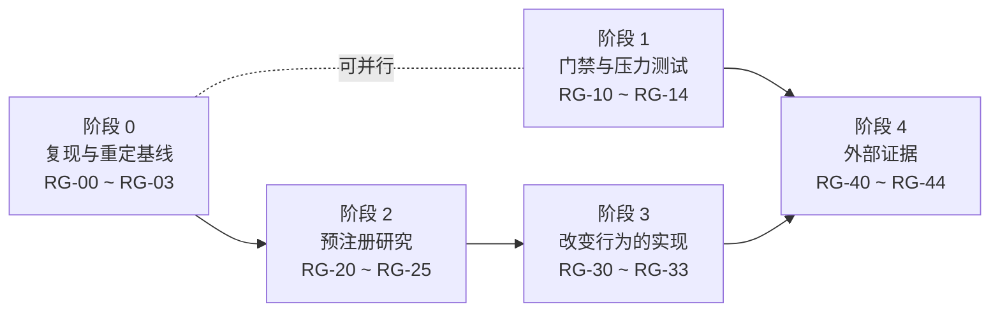

# 实盘现实断层整改：开发计划（2026-11-21）

> 状态：**草案，待所有者确认**。批次 1（阶段 0）和批次 2（RG-11）已完成，见第 8 节；其余工作包尚未开始。本文件不改策略代码与策略参数。
> 依据：[问题清单 Q1–Q18](./questions_list.md)、[综合诊断 ISS-01–12](./issues_report.md)、
> [实验报告 E1–E7](./experiments_report.md)、[实验脚本](../../../scripts/run_reality_gap_experiments.py)。
> 上级文档：[统一 Roadmap v3.0](../../unified_roadmap.md) → [开发计划](../../development_plan.md)。
> 本文件不改变 R0–R8 阶段定义和 41 项任务登记状态；`TrendBreakout` 仍为 `paused_revalidation`。
> 本文件任何一项完成，都不构成真实资金放行。

## 1. 结论

18 个问题整理成 **5 个阶段（阶段 0–4）、24 个工作包（RG-xx）**。排序不是按报告里的 P0/P1/P2 直接照搬，
而是先处理下面三个在核对当前 `main` 时发现的事实，它们决定了哪些数字能用、哪些事已经有人做过。

### 1.1 实验在当前 main 上无法复现

报告的复现指纹是 Git `4e913d0a`（2026-10-04 的合并提交），比当前 `main`（`24235b14`）落后 265 个提交。
2026-11-21 在当前工作树上核对：

| 检查 | 结果 |
| --- | --- |
| `from main import _load_local_ohlcv` | `ImportError`：该函数已搬到 [`cli/data.py`](../../../cli/data.py) |
| `from core.universe import PointInTimeUniverse` | `ModuleNotFoundError`：现为 `core.market.universe` |
| `DEFAULT_END = "2026-08-27"` | 加载器拒绝：`requested end 2026-08-27 exceeds adopted research end 2026-08-26` |
| `E5_raw_2017_2026_coverage_trap`（截止 2026-09-19） | 加载器拒绝，同上 |
| `MATIC-USDT` 截止 2026-08-26 | 加载器拒绝：采用截止日为 2024-09-09 |
| `outputs/reality_gap_experiments/summary.json` | 被 `.gitignore` 忽略，仓库里没有，本机主检出目录里也没有；三份报告的 42 组数字目前无法逐项核对 |

脚本已登记进脚本索引，但测试和 CI 工作流里没有任何一步导入或运行它，所以这些失效没有被发现。
上表是批次 1 之前的状态；批次 1 已修复脚本并补上测试（见第 8 节）。

### 1.2 实验之后基线已经变了

`4e913d0a` 之后合入、且直接影响实验数字的变化：

- **数据采用（[ADR 0041](../../adr/0041-approved-data-adoption-and-research-window.md)，2026-10-16）**：27 份 CSV 裁到 2026-08-26，
  MATIC 只保留到 2024-09-09（下架日 2024-09-10，见[采用记录](../../data_review/20261016_adoption.md)），标准入口拒绝超范围请求。
  报告中"28 币止于 2026-08-27""MATIC 退市日 2025-03-25""`intersection` 截断为 2023-10-31 ~ 2025-03-24"都是采用前的状态。
- **C1（2026-11-10）**：`trend_breakout.use_obv: false`。报告的锚点写的是"OBV 过滤"开启。
- **阶段 A 修复（2026-11-10）**：到期退出挂单锁、健康状态写盘、评分参数去重等，见[策略整改 Roadmap](../../strategy_remediation_roadmap_20261110.md)。

因此 42 组数字只能当作 **`4e913d0a` 上的历史回顾性证据**。在重跑之前，不应拿其中任何一个具体数值
（+19.09%、1.85%、10.7 倍、ρ = −0.683 等）去驱动决策或写进验收标准。定性方向大概率仍成立，但这是推断，没有验证。

> **2026-11-21 更新**：批次 1 已在当前 main 重跑。多数发现方向不变，三处明显改变（ATR 止损臂、评分排序的价值、成本放大倍数），
> 逐臂对照见[实验报告第六节](./experiments_report.md)。重跑仍是回顾性诊断，上面这条限制对新数字同样适用。

### 1.3 一部分问题已有结论或已有归属

| 问题 | 仓库里已有的工作 | 对本计划的影响 |
| --- | --- | --- |
| Q13 数据起止错配 | ADR 0020 冻结清单 + ADR 0041 研究窗口门禁，已在加载器生效（本次已实测拒绝） | 主体已关闭；残留的是宇宙文件与采用数据不一致：MATIC 一行已改，一致性检查本身还没做（RG-10） |
| Q5 健康门控僵尸资金 | [SR1-HEALTH-006](../health_policy_study_20261110_results.md)：放宽连亏门槛在 train60 更差，被否决；[SR1-HEALTH-007](../health_power_study_20261110_results.md)：区分能力不合格，结论是"要按 R 而不是按亏损次数重新设计，属于新的研究" | 不能直接改阈值；按新预注册研究走（RG-21） |
| Q3 Regime 退出占比 | 整改 Roadmap B0：regime 退出消融两段方向不一致，结论"维持现状，关闭" | 不重开退出消融；只补状态机参数邻域（RG-22，条件触发） |
| Q4 / Q2 / Q6 / Q11 | [回测研究总纲](../backtest_research_program_20261116.md) R2/R3/R5/R4 协议草案（未冻结、无脚本） | 不另起研究；把本轮发现作为冻结前的增补建议（RG-20） |
| Q8 智能配资 | 2026-10-04 已回滚，`allocation.capital` 默认关闭 | 不排期，保持关闭 |
| Q10 ATR 追踪止损 | 整改 Roadmap F-10：追踪止损漏掉成交当根最高价、`entry_price` 记参考价，**未修**（C3 未触发） | E2 的 ATR 结果混入了已知缺陷，不能用来评价 ATR 止损设计；维持纯 Donchian 常驻止损 |
| Q9 / Q16 | [剩余论文任务](../paper_remaining_tasks_20261004.md)：时钟冲突已记录；截至该记录，系统时钟**没有**修复（管理员确认未完成） | 时钟门禁（RG-11）是成本采集（RG-41）的前置 |
| Q17 / Q18 | SYS-16/17/18、[R7 runbook](../../r7_sandbox_runbook.md)、[`test_r7_fault_injection.py`](../../../tests/test_r7_fault_injection.py) | 只补缺的注入场景（RG-13） |

## 2. 必须遵守的约束

1. **观察窗已生效。** 当前登记身份是 `v3.1.1`，观察窗 **[2026-11-19, 2027-05-18)**，最早成熟日 2027-06-07
   （见[发布基线](../../repair_release_baseline.md)）。问题清单 0.2 节写的 `[2026-10-20, 2027-04-18)` 是最早的旧协议窗口。
   [冻结范围](../../../config/frozen_scope.json)包括 `core/`、`backtest/`、`strategies/`、`router/`、`composition/`、`live_trading/`、
   `ops/`、`cli/`、`signal_meta/`、`config/` 下的 `.py`、`.yaml`、`.yml`、`.json`、`.csv` 和入口脚本；`scripts/`、`analysis/`、`tests/`、`docs/` 不在其中。
2. **工作包分三类**，每个 RG 都标了类型：
   - **I 类**：不触碰冻结范围，可以直接做。
   - **II 类**：改冻结范围文件但不改变候选的回测行为（固定基线回归逐位一致）。源码身份会变，
     不构成新候选；是否出新版本并重新登记由所有者决定（先例：整改阶段 A、#117）。
   - **III 类**：改变候选行为。先写身份影响说明，再建新身份和新观察窗，不复用旧哈希。
3. **final20 已消耗，validation20 部分污染。** 本轮 42 组实验全部跑在 2020-01 ~ 2026-08 全区间上，
   E7 的 OOS 段（2023-08 ~ 2026-08）同时盖住了 validation20 和 final20 的日期。所以这些结果是回顾性诊断：
   可以支持"流程要改"（例如不按单段 IS 收益选参），**不能**用来挑参数、挑方案或证明某个改动有效。
4. **先预注册，再运行。** 新研究先写协议、登记到 `current_strategy_experiment_registry.jsonl`，
   每次尝试（含失败的）经 `ResearchEvidenceRun` 记账，受 `analysis/search_scope.py` 的有限范围约束。
5. **一个 PR 一批，一个提交一类改动**；CHANGELOG 和本文件第 8 节的状态在批次最后一个提交统一更新；仓库所有者合并。
6. **改代码不等于放行。** 准入仍走 SR5 → R7（≥56 个连续自然日、≥2 种市场状态）→ R8。

## 3. 问题与工作包对照

| 问题 | 报告优先级 | 工作包 | 类型 | 说明 |
| --- | :-: | --- | :-: | --- |
| Q1 单一多头策略失灵 | P0 | RG-20（R1）、RG-23 | I | 先看 S1/S2 能否胜过零模型；空头与均值回归重设计属于 T-4.5–4.7，不在本计划 |
| Q2 盈利集中度 | P0 | RG-14、RG-20（R5） | I | 阈值在 R5 冻结时由所有者定 |
| Q3 Regime 退出主导 | P1 | RG-22 | I | 条件触发 |
| Q4 IS 冠军陷阱 | P1 | RG-20（R2、R3） | I | 选参规则本身已是 Roadmap 第 5 节的既定口径 |
| Q5 健康门控 | P0 | RG-21 → RG-30 | I → III | 研究通过才实现 |
| Q6 路径分岔 | P0 | RG-20（R4 增补）、RG-21 | I | 新增单调性与连续性判据 |
| Q7 下游风控零触发 | P1 | RG-12 | I | 合成极端场景 |
| Q8 智能配资 | P1 | — | — | 已回滚，保持关闭，不排期 |
| Q9 成本未校准 | P0 | RG-41 | 外部证据 | 依赖 RG-11、RG-40；真实下单需所有者授权 |
| Q10 止损机制 | P1 | RG-24 | — | 维持现状；记录 E2 的混杂因素 |
| Q11 真实容量 | P1 | RG-20（R4 增补） | I | |
| Q12 执行延迟 | P2 | RG-25 | — | 延后到有细周期数据时 |
| Q13 数据错配 | P1 | RG-00、RG-10 | I | 主体已由 ADR 0041 关闭 |
| Q14 退市路径 | P1 | RG-12（场景 S4） | I | |
| Q15 借币与资金费率 | P2 | RG-33、RG-44 | III / 外部证据 | |
| Q16 时钟偏移 | P0 | RG-11、RG-40 | II / 外部证据 | |
| Q17 攻坚顺序 | P0 | 第 6 节决策 1 | — | |
| Q18 实盘故障量化 | P1 | RG-13 | I | |

## 4. 阶段与工作包

### 阶段 0：复现与重定基线（阻塞所有依赖具体数字的工作）

> **状态：已完成（批次 1，2026-11-21）。** 见第 8 节。

| ID | 内容 | 改动范围 | 验收 |
| --- | --- | --- | --- |
| RG-00 | 修复实验脚本：导入改为 `cli.data` 与 `core.market.universe`；每个标的的截止日从 `_research_policy.json` 读取（其余 29 份 2026-08-26，MATIC 2024-09-09），不再写死统一截止日；`E5_raw_2017_2026_coverage_trap` 改成"门禁验证臂"，断言加载器拒绝超范围请求，不再绕过门禁读原始文件 | `scripts/` | 脚本在当前 `main` 能跑完锚点臂；门禁验证臂得到预期的 `ValueError` |
| RG-01 | 让失效能被 CI 发现：新增冒烟测试，导入脚本模块，用小型合成数据跑一条臂并核对摘要字段；脚本支持 `--groups` 只跑指定实验组；运行元信息记录脚本哈希、配置哈希和数据采用回执摘要 | `scripts/`、`tests/` | 把导入路径改错时测试失败；全量测试通过 |
| RG-02 | 修正脚本里已知的诊断缺陷，然后在当前 `main` 重跑全部臂。缺陷：① 延迟回放里 `buy_drifts`/`sell_drifts` 按"同标的同方向的第一笔决策"匹配参考价，匹配是错的，且算完没有输出；② `E6_bear_2022` 的窗口是 2021-11-01 ~ 2022-12-31，与牛市窗口重叠一个月，标签却写 2022；③ 延迟回放用的是独立现货账户（0 延迟终值与引擎锚点不同），需在输出里标明两者不可直接相减 | `scripts/` | 全部臂 `accounting_ok`；`summary.json` 留在本地不入库，报告里记录登记哈希 |
| RG-03 | 在三份报告里**追加**带日期的"重跑与勘误"小节（不改写原文）：新旧数字对照表、七条发现各自是否仍成立、1.2 节列出的过时表述、`summary.json` 不入库的说明 | `docs/` | 断链检查通过；每条原结论都有"仍成立 / 已改变 / 无法判断"的标注 |

### 阶段 1：门禁与压力测试（与阶段 0 并行）

| ID | 内容 | 类型 | 改动范围 | 验收 |
| --- | --- | :-: | --- | --- |
| RG-10 | 宇宙文件与采用数据的一致性检查。批次 1 已确认：直接用宇宙文件加载采用数据时，引擎因 MATIC 缺少成员截止日前的最后一根 K 线而拒绝运行，该行已按决定 9 改为 2024-09-10。当时发现的两处不一致：[宇宙文件](../../../config/universe_binance_spot_1d.csv)里 `MATIC-USDT` 的 `delisted_at` 是 2025-03-25，采用数据止于 2024-09-09；`BTC-USDT` 的 `listed_at` 是 2017-08-17，文件从 2020-01-01 开始。检查项：上市日之后缺头部数据、截止日之前缺尾部数据、退市日与采用截止日不符。先做成 `scripts/data_inputs.py` 的子命令并接入 `dev.py check`；宇宙文件本身怎么改按数据采用流程由所有者确认 | I | `scripts/`、`tests/` | 对现有两处不一致报出具体标的和日期；构造的一致输入通过 |
| RG-11 | 时钟偏移硬门禁。当前 [`ops/startup_preflight.py`](../../../ops/startup_preflight.py) 没有任何时钟检查。新增：启动预检多次采样交易所 `serverTime`，复用 [`binance_depth_observer.py`](../../../core/market/binance_depth_observer.py) 的上下界算法；偏移上界超过 1.0 秒或无法测量时拒绝启动。运行期定时复检，超限时禁止新增风险并告警，减仓、止损和保护单对账照常执行 | II | `ops/`、`live_trading/`、`tests/`、runbook | 注入 ±0.5 秒通过，±5 秒和 ±31 秒拒绝，测量失败拒绝；超限期间退出路径不受影响；固定基线回归逐位一致 |
| RG-12 | 下游风控合成压力测试。第一步盘点现有测试对簇限额、`GapRiskResize`、杠杆上限、成员退出的覆盖，再补端到端场景：S1 满风险下 30 币同日 −25%（簇限额必须有至少一条非 `within_budget` 审计行）；S2 成交后开盘 ±15% 跳空（`risk_budget_reconciliation` 必须出现缩仓）；S3 满杠杆并发入场（保证金或杠杆拒单）；S4 持仓跨越退市日且退市前成交量降 90%（强平、流动性拒单、分批成交直到清仓，期末无过期估值）。每个场景同时断言 `accounting_ok` | I | `tests/` | 四个场景都触达目标防线并断言到具体审计行。发现防线不触发或有缺陷时另开 FIX，不在本包里改引擎 |
| RG-13 | 实盘故障注入补缺。现有 `test_r7_fault_injection.py` 覆盖存储损坏、停机状态持久化、熔断告警去重和冷却期。补三类：1%–5% 下单超时产生 `UNKNOWN`；停机 2–12 小时后重启（`replay_state_only()` 不补单）；REST 响应 3–10 秒。度量：恢复耗时、错过的入场数量及其在回测中的盈亏排名、持仓无保护的秒数、重复下单数（必须为 0） | I | `tests/`、`scripts/` | 每类故障有可重复的注入用例和度量表；重复下单为 0；`UNKNOWN` 期间新增风险被拒 |
| RG-14 | 集中度指标工具：去掉最大 5/10 笔后的 PF、利润 HHI，基于 `calculate_pnl_concentration` 做成研究侧函数，供 R5 调用。**不**改 `analysis/research_validation.py` 的准入逻辑，阈值等 R5 冻结 | I | `analysis/`、`tests/` | 手算样例对照通过；样本不足时返回带状态的空值 |

### 阶段 2：预注册研究（不改冻结范围，参数由调用方传入）

| ID | 内容 | 前置 | 判定 |
| --- | --- | --- | --- |
| RG-20 | 冻结并执行 R1–R6。顺序按总纲：R1 → R2 → R4 → R3 → R5 → R6。协议还是草案，冻结前建议增补三处，由所有者确认后写入协议：① R4 增加**单调性判据**，在健康门控开和关两种配置下，统计成本曲线与容量曲线的方向反转次数，以及"收益变化 ÷ 成本变化"的最大值，直接检验 Q6；② R4 容量方案增加"正常敞口"配置，并把主流币（BTC/ETH/BNB/SOL）与其余标的分开报告，回答 Q11；③ R5 增加按退出控制方（策略自身、状态切换、保护止损）的盈亏归因，回答 Q3 | 阶段 0；所有者确认草案阈值 | 按各协议的预注册规则；"证据不足"照实记录 |
| RG-21 | 新研究 SR1-HEALTH-008（编号以登记时为准）：连续风险缩放。候选在运行前写死，不超过 4 个：c0 现行规则；c1 按滚动 R 连续缩放，下限大于 0，没有 0× 断崖；c2 按策略自身权益回撤线性缩放；c3 只做波动率目标、不设健康门控（参照）。**第一步**沿用 SR1-HEALTH-007 的 cohort 级模拟和它已冻结的门槛：M(+0.2R) ≥ 0.60、M(−0.3R) ≤ 0.30、F(+0.2R) ≤ 25%；另加连续性判据：每个 cohort 的 R 扰动 ±0.05R 时平均风险倍数的变化上限（数值在协议里先定）。**第二步**只对通过第一步的候选做：在 train60 上跑引擎，再用 RG-20 的成本与容量扰动核对单调性；validation20 只用于确认 | 阶段 0 | 两步都通过才进入 RG-30；都不通过时结论是"维持现状"，这是合法结果 |
| RG-22 | 状态机参数邻域（`ma_fast`、`ma_slow`、`adx_threshold`、`atr_pct_threshold`、`stability_period`）。**只有**当 RG-20 的 R5 显示状态切换退出对盈亏的贡献超过协议里事先定的比例时才开；开的话只在 train60 上做，邻域不超过 9 个 | RG-20（R5） | 预注册；尝试数计入总纲的累计尝试数 |
| RG-23 | 策略族决策门：S1（`TrendBreakout`）和 S2（`TrendPortfolioV3`）都过不了 R1 时，没有任何对象进入调参，系统按证据定位为研究框架；有对象通过时，才讨论它的 R7 候选资格。本计划不开发新策略 | RG-20（R1） | 书面结论写入本文件第 8 节 |
| RG-24 | 止损机制：维持纯 Donchian 常驻止损，ATR 初始止损和追踪止损保持关闭。在勘误里注明 E2 的 ATR 臂受 F-10 影响。保护止损的跳空成交由 R6 第 2.2 节覆盖 | — | 不运行新实验 |
| RG-25 | 执行延迟与细周期仿真：延后。需要 1h 或 15m 数据，要先走数据采用流程；与 RG-41 的真实成交采集一起评估 | RG-41 | 暂不排期 |

### 阶段 3：改变行为的实现（只有阶段 2 给出正面证据才做）

| ID | 内容 | 类型 | 前置 |
| --- | --- | :-: | --- |
| RG-30 | 健康门控连续缩放的实现：新增默认关闭的模式开关；持久化状态的版本迁移与旧状态读取；回测、实盘和重启恢复的一致性测试；默认配置下固定基线回归逐位一致。启用它是另一个决定：写身份影响说明，建新候选身份和新观察窗 | II（实现）→ III（启用） | RG-21 两步都通过 |
| RG-31 | RG-12 暴露出的防线缺陷修复，每个缺陷单独一个 FIX | II 或 III，按缺陷定 | RG-12 |
| RG-32 | 如需在回测结果的 `data_quality` 里输出 RG-10 的覆盖告警（而不只在入口脚本检查），在引擎侧补只读字段 | II | RG-10；所有者确认有必要 |
| RG-33 | 首个实盘候选限定纯现货：把 `account.mode: spot` 作为候选配置。E4 在 `4e913d0a` 上显示现货与保证金结果相同，重跑后如仍相同，这是低风险改动，但仍是配置变化，要走候选声明 | III | RG-02；所有者决定 |

阶段 2 如果全部是"维持现状"或"证据不足"，阶段 3 只剩 RG-31/32（如有）。

### 阶段 4：外部证据（代码无法产生，需要时间和所有者操作）

| ID | 内容 | 前置 |
| --- | --- | --- |
| RG-40 | 修复采集与部署主机的时钟同步（Windows 上需要管理员权限启动并同步 `W32Time`），并另存一批复核采样，与原 31 秒冲突批次分开 | 所有者操作 |
| RG-41 | 真实成交成本采集：先用 `collect_execution_depth.py`、`collect_execution_quotes.py` 和 sandbox 的 `measure_sandbox_orders.py` 取得时钟合格的盘口与沙盒样本；真实小额订单达到 ≥10 个训练日 + ≥5 个测试日后，用 `calibrate_execution.py` 反演滑点与冲击参数。研究命令不会自动提交真实订单 | RG-11、RG-40；真实订单需所有者明确授权 |
| RG-42 | R7 连续运行（≥56 个连续自然日、≥2 种市场状态），期间按 RG-13 的场景做演练 | SYS-16、RG-11、RG-13；有通过 RG-23 的候选 |
| RG-43 | R8 小额灰度 | RG-42；人工批准 |
| RG-44 | 借币额度、借币利率与资金费率的历史证据。只有决定走保证金或永续路线时才做 | RG-33 的反向决定 |

## 5. 批次

| 批次 | 内容 | 依赖 | 交付 |
| --- | --- | --- | --- |
| 1 | RG-00、RG-01、RG-02、RG-03 | 无 | 一个 PR：脚本修复、冒烟测试、重跑记录与勘误；最后一个提交更新 CHANGELOG |
| 2 | RG-11（含 runbook 第 2 节的启动前检查项） | 无 | 一个 PR；附身份影响报告（II 类） |
| 3 | RG-10、RG-12、RG-14 | 无 | 一个 PR，三个提交 |
| 4 | RG-13 | 无 | 一个 PR |
| 5 | RG-20：协议增补、所有者冻结、研究脚本、逐个运行 R1–R6 | 批次 1；所有者确认阈值 | 每个研究一份结果文档；registry 状态更新 |
| 6 | RG-21：协议与第一步模拟；通过后第二步 | 批次 1 | 协议、脚本、结果文档 |
| 7 | 阶段 3 中有证据支持的项 | 批次 5、6 的结论 | 身份影响说明 + 一个 PR |

批次 1–4 的代码改动互不重叠，可以并行开发；它们都要改 CHANGELOG，所以按顺序逐个合并，不同时挂多个 PR
（约定见[整改 Roadmap 第 2 节](../../strategy_remediation_roadmap_20261110.md)）。批次 2、3、4 不依赖重跑结果。

每个工作包的流程沿用[开发计划第 5 节](../../development_plan.md)：确认现状 → 最小失败样本 → 最小实现 → 专项验证 →
本地 `python scripts/dev.py check` → 记录证据。I 类不要求固定基线回归；II 类必须确认回归逐位一致。

## 6. 需要所有者决定的事

| # | 决定 | 建议 | 理由 |
| --- | --- | --- | --- |
| 1 | Q17：先攻研究层还是工程运维层 | 两条线并行：批次 1–4（复现、门禁、压力测试）立即做；研究层走预注册（批次 5、6）；改变行为的实现等证据 | 批次 1–4 不依赖研究结论，也不改变候选行为；研究层在重跑之前没有可用的数字 |
| 2 | Q1：是否放弃单靠 `TrendBreakout` 上实盘 | 以 R1 的结果为准（RG-23），在此之前不做新策略开发 | final20 结论已是 `fail`；再做回顾性拆窗不会增加信息 |
| 3 | Q2：集中度是否设为准入硬指标 | 设，阈值在 R5 冻结时定 | 工具先做（RG-14），门槛不在看过结果后定 |
| 4 | Q5：是否重构健康门控 | 走 RG-21，不直接改阈值 | SR1-HEALTH-006 已证明放宽门槛更差；SR1-HEALTH-007 指明方向是按 R 重新设计 |
| 5 | Q9：何时启动真实成交采集 | 时钟修复并通过门禁之后；先沙盒后真实 | 时钟不合格的样本会像上次的 548 条一样全部作废 |
| 6 | Q15：近期是否限定纯现货 | 限定（RG-33） | 借币与资金费率没有历史证据 |
| 7 | R1–R6 草案阈值与第 4 节的三处增补 | 逐条确认后冻结 | 冻结后不得因结果改动 |
| 8 | RG-11 合入后是否出新版本并重新登记 | 由所有者定 | II 类改动会让 `main` 与已登记身份不同（同 #117 的情形） |
| 9 | 宇宙文件里 MATIC 的 `delisted_at` 是否改为 2024-09-10（**已决定并执行，2026-11-21**；属冻结范围内的改动，见第 8 节的身份影响） | 按数据采用流程确认 | 现值与采用数据矛盾：带这份宇宙文件加载采用数据时引擎直接拒绝运行（`Missing final legal exit bar before membership end`），R1–R6 用 30 币数据时会遇到同样的问题 |

## 7. 不做的事与风险

- **不按本轮 42 组结果选任何方案。** "关掉健康门控 +73%"在已见样本上成立，整改 Roadmap 第 6 节已经否定过同类论据。
- **不重跑已经关闭的研究**（regime 退出消融、放宽连亏门槛、智能配资）。
- **不在观察窗内悄悄改冻结范围。** II 类改动都附身份影响报告。
- **不处理已暂停策略的重设计**，除非它们进入 T-4.5–4.7。
- 风险：每段只有几十笔交易，研究结论噪声大；阶段 2 很可能给出多个"证据不足"。
- 重跑后的实际情况：锚点只变了 0.2 个百分点，多数结论方向不变；ATR 止损臂从 +18.08% 变成 +42.63%，说明单条臂的结果对代码和数据的小变化很敏感。
- 风险：RG-12 可能发现下游防线的真实缺陷，这会新增未估算的修复工作。
- 阶段 4 的时间由观察与真实运行决定，本计划不给日历截止日。

## 8. 状态记录

| 日期 | 事项 |
| --- | --- |
| 2026-11-21 | 批次 2 完成（RG-11，II 类）。新增 `ops/clock_guard.py`：多次读取交易所服务器时间，给出交易所减本机偏移的上下界并取交集，只有整个区间在 ±1.0 秒内才通过；超限、无法证明、读不到、样本矛盾都失败关闭。启动：`run_live.py` 在引擎初始化之前测量，未通过即写报告并返回 `2`，不进入保护性管理模式（交易所常驻止损不受影响）；启动报告新增 `exchange_clock_offset` 检查，未提供通过的测量时该检查失败。运行期：通过后每 300 秒、失败后每 30 秒复检（单次检查超过 5 秒预算后不再发起新的读取），未通过时经健康评估禁止新增风险，减仓、止损和保护单对账照常。测试 `tests/test_exchange_clock_guard.py`（27 个测试函数，参数化后 57 个用例）覆盖 ±0.5 秒通过、±5 秒与 ±31 秒拒绝、测量失败拒绝、引擎层只挡新增风险、经纪层拒绝开仓但允许减仓、恢复后放行。**身份影响**：冻结范围内 4 个文件有改动（`core/live_broker/__init__.py`、`live_trading/engine.py`、`ops/operations/startup_preflight.py`、`run_live.py`），新增 1 个（`ops/clock_guard.py`）；不改回测路径，固定基线回归通过；不构成新候选，未登记新身份（是否出新版本见决定 8）。与计划的出入：上下界算法是在 `ops/clock_guard.py` 里按同一公式重新实现的，没有导入 `binance_depth_observer.py`（那是 Binance 专用的研究客户端）；限值写死在代码里，没有加配置项或命令行开关，也没有改 `config/params.yaml`。未做：主机时钟本身的修复（RG-40，需要所有者操作）；没有在真实 sandbox 连接上跑过这道门禁，只有离线测试；不提供服务器时间接口的交易所无法通过这道门禁 |
| 2026-11-21 | 决定 9 执行：所有者确认后，宇宙文件里 `MATIC-USDT` 的 `delisted_at` 从 2025-03-25 改为 2024-09-10，来源列改为 `data_adoption_20261016`；`tests/test_phase2_reproducibility_audit.py` 的成员边界断言同步更新，实验脚本的测试增加两个用例（共 14 个）。用改后的文件重跑 49 次引擎运行，`universe_overrides` 为空，结果与改前逐项相同。**身份影响**：`config/*.csv` 在冻结范围内，所以这次修改使冻结范围身份发生变化（`dev.py identity` 报告 1 个文件：宇宙文件）。它改变的是带该宇宙文件运行时的行为：改前引擎对采用数据拒绝运行，改后可以运行，MATIC 在 2024-09-09 的最后一根 K 线上按成员退出处理。已登记的 `v3.1.1` 身份和观察窗不受影响；当前 main 在此之前就已不等于登记身份（#117、整改阶段 A、C1/C2）。本次没有登记新身份。这份计划最初把 `.csv` 误判为不在冻结范围内，决定 9 是在这个误判下提出的；所有者得知该文件在冻结范围内之后，于 2026-11-21 确认把这次修改保留在本批。影响：记录了该文件摘要的本地登记（例如 `run_trend_portfolio_v2.py` 套件）续跑时可能因输入身份变化被拒绝，届时需要重新登记（未逐个核对）。RG-10 的一致性检查和 BTC 头部缺口仍未做 |
| 2026-11-21 | 批次 1 完成（RG-00 ~ RG-03）。脚本改经 `cli.data` 读取已采用数据，各标的截止日取自 `_research_policy.json`；实验组可用 `--groups` 选择；原覆盖陷阱臂改为门禁验证；修正延迟回放的偏移匹配和 E6 的重叠窗口；运行元信息记录脚本、配置、宇宙文件、数据和采用回执的摘要。新增 `tests/test_reality_gap_experiments.py`（12 个用例）。在 `24235b14` 加未提交改动上重跑 49 次引擎运行，全部通过会计核对；三份报告追加了重跑与勘误小节。新发现：宇宙文件的 MATIC 退市日与采用数据矛盾时引擎拒绝运行（脚本在内存里覆盖，宇宙文件未改，待决定 9）。未做：没有在干净提交上复跑 |
| 2026-11-21 | 建立本文件。核对当前 `main`（`24235b14`）：实验脚本两处导入失效、研究窗口被加载器拒绝、`summary.json` 不在仓库；`ops/startup_preflight.py` 无时钟检查；宇宙文件与采用数据在 MATIC 退市日和 BTC 上市日上不一致。尚未开始任何工作包 |
