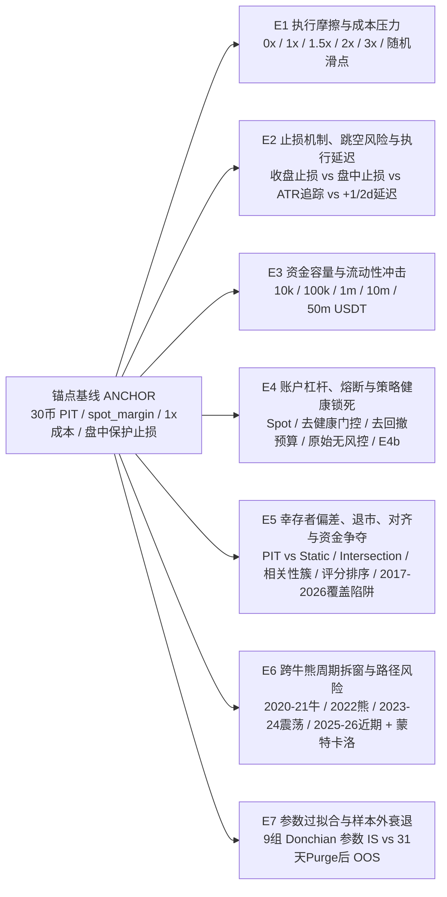

# 量化交易回测实验设计与实际交易问题实证诊断报告

> **实验脚本**：[run_reality_gap_experiments.py](../../../scripts/run_reality_gap_experiments.py)
> **原始实验数据**：[summary.json](../../../outputs/reality_gap_experiments/summary.json)
> **复现指纹**：Git `4e913d0a` ｜ Seed `42` ｜ 数据集：30 币安日线（`2020-01-01` ~ `2026-08-27`，2,431 bars，SHA-256 `ba937985…0daf`）｜ PIT 宇宙：[universe_binance_spot_1d.csv](../../../config/universe_binance_spot_1d.csv)
> **正确性校验**：全部 42 组回测运行 `accounting_ok = True`（逐 bar 会计恒等式全部通过），未修改生产配置 [params.yaml](../../../config/params.yaml)，严格规避前瞻观察窗 `[2026-10-20, 2027-04-18)`。
> **后续（2026-11-21）**：一至五节的数字来自提交 `4e913d0a`。脚本已修复并在当前 main 重跑，新旧对照、各条发现是否仍成立以及过时表述见[第六节](#六2026-11-21-重跑与勘误当前-main)；安排见[开发计划](./development_plan.md)。

---

## 一、实验设计方法论：如何用回测“逼出”实盘问题

常规回测只回答“这套参数历史赚了多少钱”，却往往掩盖实盘崩溃的真正原因。本实验套件采用**单因子控制变量 A/B 对照 + 压力梯度扫描 + 跨周期与样本外切分 + 底层事件审计**四层框架，围绕「**回测理想假设 → 真实市场摩擦**」的七个断层设计了 7 大实验组（共 42 次完整引擎运行）：

---

## 二、锚点基线（ANCHOR）深度体检

以当前仓库生产配置（`TrendBreakout(20,10)`、`spot_margin`、`commission=0.10%`、`slippage=5bps`、`spread=2bps`、`volatility_slippage=0.02`、`impact=on`、`backtest_resident=True`、`strategy_health=on`、`drawdown_budget=on`）运行 30 币种 6.6 年全样本：

| 指标 | 基线实测值 | 诊断含义 |
| --- | --- | --- |
| 区间 / K 线数 | `2020-01-01` ~ `2026-08-27`（2,431 bars） | 覆盖完整两轮加密牛熊 |
| 总收益 / CAGR | `+19.09%` / **`+2.66%`** | 6.6 年年化不及无风险利率 |
| Sharpe / 最大回撤 | `0.645` / `-4.84%` | 表面波动极低，实为极度空仓 |
| 盈利因子 PF（95% CI） | `2.40`（`[1.20, 4.49]`，status=`ok`） | 样本数 139 笔往返（199 成交腿） |
| 胜率 / 成本总额 | `41.01%` / `148.76 USDT`（佣金 40.86 + 滑点 107.90） | 滑点成本是手续费的 **2.64 倍** |
| **平均总敞口 / 持仓天数占比** | **`1.85%`** / `32.70%` | **超过 98% 的资金长期闲置** |
| **策略健康拦截率 / 冷却天数** | **167 / 306（54.6%）** / **904 天（37.2%）** | 6.6 年内状态机切换 21 次，终态仍卡在 `0.10x` |
| **盈亏集中度（Top-1 / 3 / 5 / 10）** | `40.4%` / `64.1%` / `81.0%` / **`111.0%`** | 剔除前 10 笔大赢单，其余 129 笔净亏 `-210.00 USDT` |
| 退出归因 | `Low10`: 62 / `VOLATILE`: 35 / `SIDEWAYS`: 27 / `protective_stop`: 15 | 44.6% 的平仓由 Regime 切换触发 |
| 回调覆盖率 / 未保护持仓 bar | `100.0%`（199/199） / `0` | 生命周期回调与常驻保护单链路正常 |

---

## 三、七大对照实验结果与暴露的实际交易问题

### 实验 E1：执行摩擦与成本压力测试

> **实验目的**：量化手续费、固定滑点、价差、波动率滑点与冲击成本对收益与交易路径的真实侵蚀，对比“理想零成本回测”与现实摩擦。

| 实验组 | 总收益 | CAGR | 最大回撤 | Sharpe | PF | 往返笔数 | 总成本 (USDT) | 终态风险乘数 |
| --- | --- | --- | --- | --- | --- | --- | --- | --- |
| `E1_ideal_zero_cost`（0x 理想） | **`+35.08%`** | `+4.62%` | `-6.20%` | `0.839` | `3.44` | **113** | `0.00` | `0.10` |
| `E1_baseline_1x`（生产 1x） | `+19.09%` | `+2.66%` | `-4.84%` | `0.645` | `2.40` | 139 | `148.76` | `0.10` |
| `E1_stress_1.5x`（1.5x 摩擦） | `+18.29%` | `+2.56%` | `-4.90%` | `0.620` | `2.30` | 139 | `222.64` | `0.10` |
| `E1_stress_2.0x`（2.0x 摩擦） | `+17.53%` | `+2.46%` | `-4.97%` | `0.597` | `2.22` | 139 | `296.07` | `0.10` |
| `E1_stress_3.0x`（3.0x 摩擦） | `+15.99%` | `+2.26%` | `-5.09%` | `0.550` | `2.05` | 139 | `442.13` | **`0.00`（锁入冷却）** |
| `E1_random_slip_2x_s42`（随机滑点） | `+18.20%` | `+2.55%` | `-4.92%` | `0.618` | `2.29` | 139 | `234.96` | `0.10` |

> [!WARNING]
> **暴露的实际问题 #1 — 成本引发的非线性“路径分岔（蝴蝶效应）”**：
> 从 `0x` 到 `1x` 成本，账面总交易成本仅增加 **148.76 USDT**，但总净利润却暴跌 **1,598.93 USDT**（`+35.08% → +19.09%`），**成本放大倍数高达 10.7 倍**，交易路径也从 113 笔剧变为 139 笔！根因是 1x 成本将早期盈亏边缘交易推为负值，提前触发了 `StrategyHealthMachine` 冷却阈值，令后续仓位长期被压制。此外，即使在 1x 基线下，**波动率+固定滑点成本（107.90 USDT）也是手续费（40.86 USDT）的 2.64 倍**，仅靠降费率（VIP 等级）无法解决突破策略的追价摩擦。

---

### 实验 E2：止损撮合机制、跳空风险与执行延迟

> **实验目的**：对比旧收盘止损与真实盘中常驻止损（`open -> low -> high -> close` 保守路径）、检验 ATR 追踪止损在加密高波动行情的适应性，并用 [delayed_execution.py](../../../backtest/delayed_execution.py) 量化实盘轮询/宕机延迟的净值损耗。

| 实验组 | 总收益 | 最大回撤 | Sharpe | PF | 往返笔数 | 退出归因亮点 |
| --- | --- | --- | --- | --- | --- | --- |
| `E2_legacy_close_stop`（收盘止损） | `+20.86%` | `-4.55%` | `0.713` | `2.69` | 139 | `hard_stop`: 15（次日开盘退出） |
| `E2_resident_stop_anchor`（盘中止损） | `+19.09%` | `-4.84%` | `0.645` | `2.40` | 139 | `protective_stop`: 15（盘中触价） |
| `E2_no_gap_risk_resize`（关闭跳空缩仓） | `+19.09%` | `-4.84%` | `0.645` | `2.40` | 139 | 138 笔审计均未突破 10% 容差 |
| `E2_atr_hybrid_trailing_stop`（ATR 追踪） | `+18.08%` | **`-8.67%`** | **`0.388`** | **`1.47`** | **176** | **`protective_stop`: 159（90.3%！）**，`Low10` 仅 7 次 |

**独立延迟执行回放（338 笔锚点现货决策，IOC 市价单）**：
- **0 天延迟（次日开盘即时执行）**：终值 `12,386.58 USDT`（`+23.87%`）
- **+1 天延迟（模拟宕机/补帧/接口超时延迟）**：终值 `12,260.43 USDT`（`+22.60%`，单次延迟侵蚀 `-1.26%`）
- **+2 天延迟**：终值 `12,188.45 USDT`（`+21.88%`，侵蚀 `-1.98%`）

> [!IMPORTANT]
> **暴露的实际问题 #2 — 盘中插针止损虚高误差与 ATR 追踪止损反噬**：
> 1. 传统收盘止损回测相对真实交易所常驻止损单，**虚增收益 `+1.77%`、虚增 PF `+0.29`**（实盘挂单会被盘中插针扫出）。
> 2. 开启 ATR 混合追踪止损后，加密日线高插针噪声导致 **90.3% 的持仓（159/176）被提前扫损出局**，原有 Donchian 退出几乎沦为死代码（仅 7 次），**最大回撤几乎翻倍（`-4.84% → -8.67%`），Sharpe 暴跌 40%**。
> 3. 24/7 连续加密现货日线天然缺乏隔夜跳空，导致 `entry_risk`（`GapRiskResize`，容差 10%）在 138 笔开仓中触发 **0 次**；但在交易所停机维护恢复、极端插针或股票/期货隔夜跳空场景中，该模块仍须专门用跳空故障注入测试，不能因日线现货零触发而误以为不存在跳空风险。

---

### 实验 E3：资金容量与流动性参与率陷阱

> **实验目的**：按 `10k → 100k → 1m → 10m → 50m USDT` 梯度扩容，测试 `max_participation_rate=5%` 分批成交与非线性冲击成本（$\text{impact} = 0.10 \times p^{1.5}$）对大资金实盘的约束。

| 初始资金 | 总收益 | 最大回撤 | Sharpe | 往返 / 成交腿 | 部分成交 | 平均 / 最大参与率 | 冲击成本 (USDT) | 健康切换 / 终态乘数 |
| --- | --- | --- | --- | --- | --- | --- | --- | --- |
| `10k` | `+19.09%` | `-4.84%` | `0.645` | 139 / 338 | `0` | `0.000%` / `0.006%` | `0.00` | `21` / `0.10` |
| `100k` | `+19.09%` | `-4.84%` | `0.645` | 139 / 338 | `0` | `0.003%` / `0.063%` | `0.07` | `21` / `0.10` |
| `1m` | `+19.09%` | `-4.84%` | `0.645` | 139 / 338 | `0` | `0.032%` / `0.626%` | `21.95` | `21` / `0.10` |
| `10m` | `+19.04%` | `-4.84%` | `0.643` | 139 / 342 | **`4`** | `0.317%` / **`5.000%`** | `6,213.37` | `21` / `0.10` |
| **`50m`** | **`+76.44%`** | **`-11.68%`** | **`1.077`** | **160 / 787** | **`92`** | `1.102%` / **`5.000%`** | **`191,072.55`** | **`16` / `0.25`** |

> [!CAUTION]
> **暴露的实际问题 #3 — 大资金分批成交陷阱与容量曲线反常跳变**：
> 1. 10M USDT 即开始触及 5% 参与率上限；到 50M USDT 时，**部分成交暴增至 92 次、成交腿翻倍至 787 笔、仅市场冲击成本即高达 19.1 万 USDT**，同时触发日内 5% 熔断与 10% 减仓熔断。
> 2. **极其危险的反常现象**：50M 资金的收益率竟从 `+19.04%` 飙升至 `+76.44%`！原因并非“大资金更好赚”，而是**跨 bar 分批成交偶然改变了一笔亏损单的平仓归属，使 `StrategyHealthMachine` 绕过了早期锁死分支**（切换次数 `21 → 16`，仓位乘数停在 `0.25x` 而非 `0.10x`）。这再次印证：**硬阈值离散状态机导致策略表现对微小成交细节极度敏感，实盘完全不可预测**。
> 3. **隐藏的容量错觉**：1M–10M 看似“毫无衰减”，是因为锚点基线平均敞口被健康门控压在 **1.85%**；如果恢复正常 1.0x 仓位，真实容量拐点将提前 **5–10 倍**（约 1M–2M USDT 即在中小市值山寨币上撞墙）。

---

### 实验 E4 & E4b：账户模式、回撤熔断与策略健康锁死（最核心发现）

> **实验目的**：逐层剥离 `strategy_health`、`drawdown_budget`、分级熔断与 `spot_margin`，暴露多层风控叠加后的真实资金利用率与模块屏蔽效应。

| 实验组 | 总收益 | CAGR | 最大回撤 | Sharpe | 往返笔数 | 平均 / 最大敞口 | 持仓时间占比 | 健康拦截信号 / 冷却天 |
| --- | --- | --- | --- | --- | --- | --- | --- | --- |
| `E4_margin_anchor`（默认全开） | `+19.09%` | `+2.66%` | `-4.84%` | `0.645` | 139 | **`1.85%`** / `31.6%` | `32.7%` | **167 / 306**（904 天） |
| `E4_spot_unlevered`（纯现货） | `+19.09%` | `+2.66%` | `-4.84%` | `0.645` | 139 | `1.85%` / `31.6%` | `32.7%` | 167 / 306（904 天） |
| `E4_no_drawdown_budget`（去回撤预算） | `+19.74%` | `+2.74%` | `-4.91%` | `0.634` | 139 | `1.85%` / `31.6%` | `32.7%` | 167 / 306（904 天） |
| **`E4_no_health_gate`**（去健康门控） | **`+73.23%`** | **`+8.61%`** | `-15.24%` | **`0.940`** | 129 | `5.90%` / `36.6%` | `42.0%` | `0 / 339`（0 天） |
| **`E4_raw_no_breaker_no_health`**（裸策略） | **`+266.57%`** | **`+21.56%`** | **`-31.48%`** | `0.928` | 165 | `15.60%` / **`113.6%`** | `42.8%` | `0 / 254`（0 天） |
| `E4b_full_risk_spot`（去健康+纯现货） | `+73.23%` | `+8.61%` | `-15.24%` | `0.940` | 129 | `5.90%` / `36.6%` | `42.0%` | 底层仍被 `drawdown_budget` 限仓 |
| `E4b_full_risk_no_cluster`（去健康+去簇限额） | `+73.23%` | `+8.61%` | `-15.24%` | `0.940` | 129 | `5.90%` / `36.6%` | `42.0%` | 339 次簇审计全部 `within_budget` |
| **`E4b_full_risk_no_scoring`**（去健康+字母序） | **`+65.46%`** | `+7.86%` | **`-16.17%`** | `0.883` | 128 | `5.50%` / `35.9%` | `41.2%` | 字母序抢资导致净值少赚 `-7.77%` |

> [!CAUTION]
> **暴露的实际问题 #4 — 多层叠加风控制造“僵尸资金”并静默屏蔽下游风控**：
> 1. **健康状态机死循环**：锚点基线在 `2020-05-26` 触发连续 3 组亏损进入冷却后，由于 `unified_recovery` 要求从 `0.10x` 逐级晋升（每级需同时满足 ≥30 天、≥5 组、≥3 币种、总 R>0 且剔除最佳组仍 >0），导致策略在 **`cooldown (0x) ↔ probation (0.10x)` 死循环长达 6 年（21 次切换）**，**再也没回到 `1.0x` 正常仓位**，平均敞口仅 **1.85%**，白白损失 98% 的资金效率。
> 2. **下游风控的“虚假安全感”**：当 `strategy_health` 把仓位锁死在 `0.10x` 后，`spot_margin` 杠杆、`portfolio_risk` 相关性簇上限（`1.5x/2.0x`）、`candidate_scoring`、`entry_risk` 几乎全部失去验证机会（5 组对照全部输出完全一致的 `+19.09%`！）。甚至关闭健康门控后（`E4b`），`drawdown_budget` 又立刻拦截了 `142` 次减仓和 `210/339`（61.9%）个候选信号，导致 `portfolio_risk` 簇限额（339/339 全通过）依然从未在实盘回测中真正经受压力测试！
> 3. **裸策略真实风险被低估**：剥离全部保护后的原始策略虽然收益高达 `+266.57%`，但最大回撤达 **`-31.48%`**、峰值杠杆达 **`113.6%`**，说明风控确实必要，但当前参数配置从“缺风控”矫枉过正到了“过度窒息”。

---

### 实验 E5：幸存者偏差、退市、对齐方式与资金分配偏差

> **实验目的**：检验 PIT 宇宙、对齐模式（`union` vs `intersection`）、本仓库真实数据起止不齐问题，以及智能配资对组合的影响。

| 实验组 | 实际有效区间 | K 线数 | 总收益 | 最大回撤 | Sharpe | 往返笔数 | 暴露的问题 |
| --- | --- | --- | --- | --- | --- | --- | --- |
| `E5_pit_union_anchor` | `2020-01-01` ~ `2026-08-27` | 2,431 | `+19.09%` | `-4.84%` | `0.645` | 139 | 基准对照 |
| `E5_static_no_pit` | `2020-01-01` ~ `2026-08-27` | 2,431 | `+19.09%` | `-4.84%` | `0.645` | 139 | `MATIC` 末次平仓在退市前，**单次历史巧合掩盖了退市风险** |
| **`E5_intersection_align`** | **`2023-10-31` ~ `2025-03-24`** | **399** | `+15.56%` | `-6.01%` | **`N/A`** | **22（样本不足）** | **丢弃 83.6% 历史数据**，被最晚上市 `TIA` 与最早退市 `MATIC` 双向截断 |
| **`E5_raw_2017_2026_coverage_trap`** | **`2017-11-06` ~ `2026-09-19`** | **3,240** | **`+40.85%`** | `-4.84%` | `0.849` | 153 | **本仓库真实数据错配虚增 `+21.76%` 收益！** |
| `E5_smart_capital_alloc` | `2020-01-01` ~ `2026-08-27` | 2,431 | `+24.50%` | **`-10.56%`** | `0.552` | 127 | 波动率/相关性配资放大仓位并触发 10% 熔断，Sharpe 反降 |

> [!WARNING]
> **暴露的实际问题 #5 — 数据覆盖错配陷阱与对齐截断**：
> 1. **本仓库直接存在的数据陷阱**：检查 `data/binance/1d/*.csv` 发现，`BTC_USDT.csv` 与 `ETH_USDT.csv` 起止为 `2020-01-01 ~ 2026-09-19`，而其余 28 个币种包含 `2017–2019` 数据却在 **`2026-08-27` 提前截止**（且 `universe_binance_spot_1d.csv` 标注 BTC/ETH 上市日为 `2017-08-17`）。若直接跑全区间，2017–2019 实际是“缺 BTC/ETH 的山寨币幸存偏差”，末尾 23 天只有 BTC/ETH 更新而 28 币估值停滞，导致收益率凭空翻倍至 **`+40.85%`**！
> 2. **候选排序的实盘资金争夺**：在全仓位模式（`E4b`）下，关闭经济评分退回字母序会导致收益下降 `-7.77%`（`+73.23% → +65.46%`），说明并发信号下若无经济排序，实盘资金会被 `AAVE/ADA/APT` 等字母靠前标的抢占。

---

### 实验 E6：跨市场周期拆窗与蒙特卡洛路径风险

> **实验目的**：拆穿“全周期正收益”的均值幻觉，检验策略在不同市场周期（大牛/深熊/震荡/近期）的存活能力及盈利集中度。

| 市场周期窗口 | 总收益 | 最大回撤 | Sharpe | PF（状态） | 往返笔数 | 胜率 | Top-3 利润占比 |
| --- | --- | --- | --- | --- | --- | --- | --- |
| `E6_bull_2020_2021`（单边牛市） | **`+14.31%`** | `-4.18%` | **`1.215`** | `3.51 (ok)` | 47 | `55.3%` | `78.8%` |
| `E6_bear_2022`（深熊市） | **`-5.50%`** | `-6.79%` | **`-0.968`** | **`0.00 (insufficient)`** | 6 | **`0.0%`** | N/A |
| `E6_chop_2023_2024`（震荡轮动） | `+1.68%` | **`-11.31%`** | `0.173` | `1.17 (ok)` | 64 | `46.9%` | **`367.5%`** |
| `E6_recent_2025_2026`（近期） | **`-3.49%`** | `-5.58%` | **`-0.462`** | **`0.25 (insufficient)`** | 20 | `35.0%` | N/A |

- **蒙特卡洛交易顺序重排（2,000 次，Seed 42）**：锚点 139 笔交易随机重排后，最大回撤均值 `-305.45 USDT`，**5% 尾部最差回撤达 `-442.93 USDT`**（接近当前真实实现回撤 `-483.73 USDT`）。

> [!CAUTION]
> **暴露的实际问题 #6 — 严重依赖单边牛市、近 3.6 年 Alpha 显著衰退与极度尾部依赖**：
> 1. 全周期 `+19.09%` 利润中绝大部分来自 `2020–2021` 单边牛市（`+14.31%`）；在 `2022` 熊市 6 笔全败（胜率 0%），在 **`2023–2026` 最近 3.6 年整体滞涨转亏**（2023–2024 仅 `+1.68%` 却承受 `-11.31%` 回撤，2025–2026 亏 `-3.49%`、PF 仅 `0.25`）。
> 2. **“错过 5 笔就白干”风险**：全样本 Top-5 贡献 `81.0%`、Top-10 贡献 `111.0%`；2023–2024 震荡期 Top-3 贡献高达 **`367.5%`**！实盘任何一次宕机、API 限流、余额不足或 `UNKNOWN` 订单挂起，只要错过年度前 3–5 笔突破行情，全年立刻转亏。

---

### 实验 E7：样本内外参数过拟合检验（31 天 Purge 切分）

> **实验目的**：在 `IS (2020-01-01 ~ 2023-06-30)` 与 `OOS (2023-08-01 ~ 2026-08-27)` 之间保留 31 天隔离期（Purge/Embargo），扫描 9 组 `(entry_window, exit_window)` 网格，测试 IS 选参在实盘模拟 OOS 的衰减程度。

| 参数 `(entry, exit)` | IS 收益 | IS Sharpe | IS MDD | IS 笔数 | OOS 收益 | OOS Sharpe | OOS MDD | OOS 笔数 | OOS 衰减 |
| --- | --- | --- | --- | --- | --- | --- | --- | --- | --- |
| `(10, 5)` | `+48.46%` | `1.118` | `-11.27%` | 88 | `+8.17%` | `0.410` | `-7.43%` | 80 | **-83%** |
| **`(15, 5)`（IS 冠军）** | **`+78.75%`** | **`1.354`** | `-12.30%` | 86 | **`+9.59%`** | **`0.510`** | `-6.70%` | 73 | **-88%** |
| `(20, 5)`（IS 亚军） | `+70.21%` | `1.254` | `-14.20%` | 87 | `+9.06%` | `0.484` | `-7.67%` | 75 | **-87%** |
| `(15, 10)` | `+12.67%` | `0.783` | `-3.94%` | 63 | `+12.96%` | `0.638` | `-10.15%` | 60 | +2% |
| `(20, 10)`（默认） | `+12.26%` | `0.767` | `-4.18%` | 63 | **`+19.06%`** | **`1.153`** | `-4.02%` | 51 | +55% |
| `(20, 15)` | `+13.80%` | `0.867` | `-3.60%` | 63 | `+10.88%` | `0.680` | `-4.39%` | 64 | -21% |
| `(30, 10)` | `+11.84%` | `0.741` | `-4.18%` | 65 | `+12.65%` | `0.627` | `-10.29%` | 61 | +7% |
| `(30, 15)` | `+13.32%` | `0.835` | `-3.60%` | 65 | `+10.25%` | `0.652` | `-4.11%` | 67 | -23% |
| `(40, 20)` | `+13.79%` | `0.873` | `-3.56%` | 71 | **`+20.97%`** | `0.987` | `-6.65%` | 49 | +52% |

> [!CAUTION]
> **暴露的实际问题 #7 — 强烈的 IS/OOS 排名反转（Spearman $\rho = -0.683$）**：
> IS 与 OOS 收益率呈**显著负相关（-0.683）**！样本内狂赚 `+78.75%` 的冠军参数 `(15, 5)` 放到样本外暴跌 88% 跌至倒数第三（`+9.59%`），所有 `exit=5` 的高收益参数在 OOS 集体崩塌——因为它们在 IS 阶段恰好碰巧绕开了健康状态机锁死，而非具备更优的普适边缘。这证明：**任何按样本内总收益/夏普直接选参上线的流程，在实盘中都会买到路径幸运儿并在样本外迅速失灵**。

---

## 四、纯 OHLCV 回测的盲区：必须补充的实盘/沙盒故障注入实验

结合对 [tick_orchestrator.py](../../../live_trading/tick_orchestrator.py)、[catchup.py](../../../live_trading/catchup.py) 与 [paper_remaining_tasks_20261004.md](../../../docs/research/paper_remaining_tasks_20261004.md) 的代码与运维审计，以下 4 类实盘问题**无法被纯历史 K 线回测覆盖**，必须纳入沙盒/仿真故障注入测试矩阵：

| 盲区编号 | 实际交易问题 | 项目现状证据 | 建议补充实验 |
| --- | --- | --- | --- |
| **L1** | **主机时钟漂移（Clock Skew）** | 本机 `W32Time` 停服曾导致比币安服务器慢 **30.98–31.10 秒**，548 条盘口快照全部作废 | 在 `preflight` 中强制校验 `abs(exchange_time - local_time) < 1.0s`，模拟 ±5s/±30s 漂移测试 K 线闭合误判 |
| **L2** | **`UNKNOWN` 订单悬停阻断** | 网络超时丢回包后，系统锁定新增风险直至人工核实执行 [resolve_live_order.py](../../../resolve_live_order.py)；而回测 100% 确定确认 | 注入 1%~5% 随机下单超时/回包丢失事件，量化停机窗口错过 Top 趋势行情的期望收益损失 |
| **L3** | **重启补帧漏单与单线程保护竞态** | `replay_state_only()` 只推状态不补发历史订单；`ProtectionSchedule` 在单线程内运行，长耗时阻塞调用会推迟保护单对账 | 模拟进程随机崩溃重启（每 30 天停机 2–12 小时）+ REST 慢响应（3–10s），观测漏单与保护单延迟暴露 |
| **L4** | **真实成交成本与借币可得性未校准** | 现有真实成交样本仍为 **0**；`borrow_availability_required=false`、`default_borrow_limit_qty=1e12` 均非真实市场约束 | 接入小额实盘/沙盒全链路采集（报价→决策→提交→成交→实收费用），用实际 `Implementation Shortfall` 反演校准 `cost_model.py` |

---

## 五、问题汇总与工程/策略整改优先级

| 优先级 | 问题 | 实证核心指标 | 建议整改方向 |
| --- | --- | --- | --- |
| **P0** | **健康状态机与风控叠加导致僵尸资金 & 路径分岔** | 平均敞口仅 `1.85%`、拦截 `54.6%` 信号、1x 成本放大 10.7 倍、50M 容量反常跳变 `+76.44%` | 用**连续平滑仓位衰减**（如基于滚动波动率/回撤连续缩放）替代硬阈值“连亏 3 组即打入 0.10x 多年死循环”，避免离散蝴蝶效应并恢复合理资金利用率 |
| **P0** | **近 3.6 年 Alpha 衰退 & 单边牛市/极少数交易依赖** | 2022 `-5.50%`、2025–26 `-3.49%`、Top-10 贡献 `111.0%`、2023–24 Top-3 贡献 `367.5%` | 不宜仅靠单一多头 `TrendBreakout` 上线实盘；需补齐非相关策略族（如经过 OOS 验证的横截面动量/组合目标控制 `TrendPortfolioV3`、空头或波动中性策略）以分散单笔尾部依赖 |
| **P1** | **数据覆盖不齐导致回测失真** | `BTC/ETH` 缺 2017–2019 且末尾比 28 币多 23 天，全区间收益虚增 `+21.76%` | 统一补齐并冻结 30 币完整 `_manifest.json` 哈希与起止边界；在回测入口增加“同批标的末尾日期错位告警” |
| **P1** | **下游风控长期处于“未压力测试”盲区** | `portfolio_risk` 簇限额 339/339 全通过、`GapRiskResize` 138/138 零触发、`MATIC` 未跨退市日 | 建立**强制压力注入测试**（高杠杆并发暴跌测试簇限额、合成 ±15% 跳空测试 `GapRiskResize`、强持仓跨退市日测试退市强平） |
| **P1** | **IS 选参严重过拟合** | IS/OOS Spearman $\rho = -0.683$，IS 冠军 `(15,5)` 在 OOS 暴跌 88% | 禁止按单段 IS 收益选参；改用多窗口 Walk-Forward 中位数/下分位 Sharpe + 参数邻域平滑性打分（如 Deflated Sharpe / 稳定高原选参） |
| **P2** | **实盘基础设施与真实成本校准** | 时钟偏移 31s、真实成交校准样本 0 笔 | 上线前强制完成主机 NTP 同步校验、沙盒 `UNKNOWN`/重启故障演练及小资金实盘成本校准闭环 |

---

## 六、2026-11-21 重跑与勘误（当前 main）

> 本节是追加记录，上文一至五节保持原样，数字仍是提交 `4e913d0a` 上的结果。
> 重跑属于**回顾性诊断**：区间盖住了 validation20 与 final20 的日期，可以支持"流程要改"，不能用来选参数、选方案或证明某个改动有效。
> 安排与约束见[开发计划](./development_plan.md)阶段 0（RG-00 ~ RG-03）。

### 6.1 运行身份

| 项 | 值 |
| --- | --- |
| 源码 | `24235b14` 加上本批未提交的改动（脚本、测试、文档、宇宙文件），工作区不干净 |
| 脚本摘要（LF 规范化 SHA-256） | `bc72233b…08a9` |
| `config/params.yaml` 摘要 | `a3411316…8df8` |
| 宇宙文件摘要 | `a0a1121e…822e`（MATIC 退市日改为 2024-09-10 之后） |
| 30 份 CSV 联合摘要（LF 规范化） | `e089db6d…d258` |
| 数据采用回执摘要 | `3911765c…ec29`（[回执](../../data_review/20261016_adoption_receipt.json)） |
| 窗口与种子 | `2020-01-01` ~ `2026-08-26`，Seed `42` |
| 规模 | 49 次引擎运行，全部 `accounting_ok = True`；另有延迟回放、蒙特卡洛、研究窗口门禁验证各一项；总耗时约 7 分钟 |
| 产物 | `outputs/reality_gap_experiments/summary.json`，只在本地，不入库 |

摘要都按 LF 规范化计算，所以与文首的 `ba937985…0daf`（原样字节）不可比。

### 6.2 与原实验的口径差异

1. **数据**：经标准研究入口读取已采用数据。29 份 CSV 止于 2026-08-26，`MATIC-USDT` 止于 2024-09-09（[ADR 0041](../../adr/0041-approved-data-adoption-and-research-window.md)）。
2. **入场**：当前配置 `trend_breakout.use_obv: false`（C1），原实验是 OBV 确认开启。
3. **宇宙文件与采用数据不一致**：[宇宙文件](../../../config/universe_binance_spot_1d.csv)里 MATIC 的 `delisted_at` 是 2025-03-25。
   直接用它加载采用数据，引擎会拒绝运行：`Missing final legal exit bar before membership end: MATIC-USDT`。
   第一次重跑时脚本在内存里把 MATIC 的成员截止日改成 2024-09-10（采用截止日的次日）。
   随后所有者决定把宇宙文件里的 `delisted_at` 改成 2024-09-10，并用改后的文件再跑了一遍：`universe_overrides` 为空，各臂的结果与第一次逐项相同（两次用的成员截止日本来就一样）。本节的数字和 6.1 的摘要以第二次为准。
   脚本保留了这层检查：以后再有成员截止日晚于采用数据的标的，会被改到采用截止日的次日并记录在 `universe_overrides` 里。
4. **E6 窗口**：改成首尾相接的日历窗口（2020–2021、2022、2023–2024、2025 至 2026-08-26）。原窗口里牛市止于 2021-11-30、熊市起于 2021-11-01，重叠一个月。所以 E6 的新旧差异里混有窗口变化。
5. **`E5_raw_2017_2026_coverage_trap`** 改成门禁验证：现在超范围请求会被拒绝，该臂不能也不应再读取原始文件。原文的 `+40.85%` 和"虚增 `+21.76%`"在当前 main 上无法复核。
6. **延迟回放**：按订单号把每笔成交对应到它自己的决策来计算价格偏移（原脚本按"同标的同方向的第一笔决策"匹配，且没有输出）；输出里注明回放账户与引擎锚点不可直接相减。

### 6.3 锚点

| 指标 | `4e913d0a` | 当前 main |
| --- | --- | --- |
| 总收益 / CAGR | `+19.09%` / `+2.66%` | `+18.88%` / `+2.63%` |
| Sharpe / 最大回撤 | `0.645` / `-4.84%` | `0.634` / `-4.84%` |
| PF（95% CI） | `2.40`（`[1.20, 4.49]`） | `2.33`（`[1.14, 4.39]`） |
| 往返笔数 / 成交腿 / 胜率 | 139 / 338 / `41.0%` | 141 / 342 / `40.4%` |
| 成本（佣金 + 滑点） | `148.76`（`40.86` + `107.90`） | `153.41`（`41.73` + `111.68`），滑点是佣金的 2.68 倍 |
| 平均敞口 / 持仓天数占比 | `1.85%` / `32.7%` | `1.88%` / `32.7%` |
| 健康拦截 / 冷却天数 | 167 / 306（54.6%）/ 904 天 | 173 / 314（55.1%）/ 904 天 |
| 状态切换次数 / 终态倍数 | 21 / `0.10` | 22 / `0.25` |
| 盈亏集中度 Top-1 / 3 / 5 / 10 | `40.4%` / `64.1%` / `81.0%` / `111.0%` | `40.9%` / `64.8%` / `81.8%` / `112.1%` |
| 去掉前 10 笔后的净盈亏 | `-210.00` | `-228.42` |
| 退出归因 | `Low10` 62 / `VOLATILE` 35 / `SIDEWAYS` 27 / 保护止损 15 | 63 / 35 / 27 / 16 |
| 蒙特卡洛回撤均值 / 5% 分位 | `-305.45` / `-442.93` | `-313.49` / `-463.81` |

### 6.4 各组对照

**E1 成本**

| 实验臂 | `4e913d0a` 收益 / 笔数 | 当前 main 收益 / 笔数 | 说明 |
| --- | --- | --- | --- |
| `E1_ideal_zero_cost` | `+35.08%` / 113 | `+29.16%` / 127 | 净盈亏比 1× 多 `1,028.28`，是 1× 总成本 `153.41` 的 6.7 倍（原为 10.7 倍） |
| `E1_stress_1.5x` | `+18.29%` / 139 | `+18.05%` / 141 | |
| `E1_stress_2.0x` | `+17.53%` / 139 | `+17.27%` / 141 | |
| `E1_stress_3.0x` | `+15.99%` / 139 | `+15.84%` / 141 | 终态倍数 `0.10`（试运行）；原为 `0.00`（冷却） |
| `E1_random_slip_2x_s42` | `+18.20%` / 139 | `+17.94%` / 141 | |

成本放大后 `risk_budget_reconciliation` 里开始出现超限或缩仓记录：1× 为 0 / 139，1.5× 为 1，2× 为 2，3× 为 6。

**E2 止损与延迟**

| 实验臂 | `4e913d0a` | 当前 main |
| --- | --- | --- |
| `E2_legacy_close_stop` | `+20.86%`，PF `2.69` | `+20.74%`，PF `2.63`（比常驻止损多 1.86 个百分点、PF 多 0.30） |
| `E2_no_gap_risk_resize` | 与锚点相同 | 与锚点相同 |
| `E2_atr_hybrid_trailing_stop` | `+18.08%`，回撤 `-8.67%`，Sharpe `0.388`，PF `1.47`，176 笔，保护止损 159 笔（90.3%） | `+42.63%`，回撤 `-13.73%`，Sharpe `0.613`，PF `1.75`，170 笔，保护止损 153 笔（90.0%），`Low10` 8 笔 |
| 延迟回放 +0 / +1 / +2 天 | `12,386.58` / `12,260.43` / `12,188.45` | `12,390.64` / `12,238.79` / `12,131.49`（+1 天少 1.52 个百分点，+2 天少 2.59 个百分点；342 笔决策） |

延迟回放的买入平均不利偏移：0 天 6 bps，+1 天 216 bps，+2 天 237 bps。卖出一侧为负值（成交价好于参考价），其中包含保护止损成交，回放把它们当作市价单在可用时点的开盘成交，这一侧不宜解读。

**E3 资金容量**

| 初始资金 | `4e913d0a` | 当前 main |
| --- | --- | --- |
| `10k` / `100k` / `1m` | 都是 `+19.09%` | `+18.88%` / `+18.88%` / `+18.87%` |
| `10m` | `+19.04%`，部分成交 4，冲击成本 `6,213` | `+18.82%`，部分成交 4，冲击成本 `6,630` |
| `50m` | `+76.44%`，回撤 `-11.68%`，Sharpe `1.077`，160 笔 / 787 成交腿，部分成交 92，冲击成本 `191,073`，切换 16 次 | `+71.84%`，回撤 `-14.34%`，Sharpe `1.045`，167 笔 / 812 成交腿，部分成交 98，冲击成本 `192,253`，切换 16 次，健康拦截 36 / 325 |

**E4 与 E4b 风控消融**

| 实验臂 | `4e913d0a` | 当前 main |
| --- | --- | --- |
| `E4_spot_unlevered` | 与锚点相同 | 与锚点相同 |
| `E4_no_drawdown_budget` | `+19.74%`，回撤 `-4.91%` | `+19.53%`，回撤 `-5.27%` |
| `E4_breaker_timed_recovery` | 原文未列 | 与锚点相同 |
| `E4_no_health_gate` | `+73.23%`，回撤 `-15.24%`，Sharpe `0.940`，129 笔，平均敞口 `5.90%` | `+72.08%`，回撤 `-15.44%`，Sharpe `0.944`，130 笔，平均敞口 `5.61%`，回撤预算减仓 138 次 |
| `E4_raw_no_breaker_no_health` | `+266.57%`，回撤 `-31.48%`，Sharpe `0.928`，最大敞口 `113.6%` | `+233.31%`，回撤 `-33.47%`，Sharpe `0.875`，166 笔，最大敞口 `108.6%` |
| `E4b_full_risk_spot` / `no_cluster` / `no_gap_resize` | 与 `E4_no_health_gate` 相同 | 与 `E4_no_health_gate` 相同（`GapRiskResize` 0 / 129） |
| `E4b_full_risk_no_scoring` | `+65.46%`（少 7.77 个百分点） | `+70.14%`（少 1.94 个百分点），回撤 `-16.03%` |

**E5 宇宙、对齐与配资**

| 实验臂 | `4e913d0a` | 当前 main |
| --- | --- | --- |
| `E5_static_no_pit` | 与锚点相同 | 与锚点相同（MATIC 最后一笔成交在 2023-11-22） |
| `E5_intersection_align` | `2023-10-31` ~ `2025-03-24`，399 根，`+15.56%`，22 笔 | `2023-10-31` ~ `2024-09-09`，315 根（丢掉 87.0%），`+13.46%`，23 笔，PF 样本不足 |
| `E5_no_cluster_risk` / `E5_no_scoring_alphabetical` | 与锚点相同 | 与锚点相同 |
| `E5_smart_capital_alloc` | `+24.50%`，回撤 `-10.56%`，Sharpe `0.552`，PF `2.03` | `+19.24%`，回撤 `-13.01%`，Sharpe `0.452`，PF `1.69`，129 笔 |
| `E5_research_window_gate` | 无 | 三个超范围请求全部被拒（`rejected_as_expected`） |

**E6 周期拆窗**（窗口已改，见 6.2 第 4 条）

| 窗口 | `4e913d0a` | 当前 main |
| --- | --- | --- |
| 2020–2021 | `+14.31%`，Sharpe `1.215`，47 笔 | `+13.88%`，Sharpe `1.152`，PF `3.27`，49 笔，Top-3 `81.2%` |
| 2022 | `-5.50%`，6 笔，胜率 0% | `-3.51%`，5 笔，胜率 0%，回撤 `-6.79%` |
| 2023–2024 | `+1.68%`，回撤 `-11.31%`，Top-3 `367.5%` | `+1.87%`，回撤 `-11.34%`，PF `1.19`，65 笔，Top-3 `331.4%` |
| 2025 至 2026-08 | `-3.49%`，PF `0.25` | `-3.30%`，PF `0.30`（样本不足），20 笔 |

每个窗口都从空账户和空指标历史开始，前几周无法交易（引擎预热加上状态机需要的 60 根历史）。2022 年这个窗口只有 365 根，受影响最大。

**E7 样本内外**

| 参数 | IS 收益（旧 → 新） | OOS 收益（旧 → 新） |
| --- | --- | --- |
| `(10, 5)` | `+48.46%` → `+47.01%` | `+8.17%` → `+8.79%` |
| `(15, 5)` | `+78.75%` → `+81.53%` | `+9.59%` → `+8.17%` |
| `(20, 5)` | `+70.21%` → `+78.23%` | `+9.06%` → `+8.17%` |
| `(15, 10)` | `+12.67%` → `+12.20%` | `+12.96%` → `+19.29%` |
| `(20, 10)` | `+12.26%` → `+11.84%` | `+19.06%` → `+19.29%` |
| `(20, 15)` | `+13.80%` → `+13.32%` | `+10.88%` → `+10.79%` |
| `(30, 10)` | `+11.84%` → `+11.84%` | `+12.65%` → `+19.29%` |
| `(30, 15)` | `+13.32%` → `+13.32%` | `+10.25%` → `+10.79%` |
| `(40, 20)` | `+13.79%` → `+13.79%` | `+20.97%` → `+21.23%` |

Spearman ρ：`-0.683` → `-0.724`。IS 冠军仍是 `(15, 5)`，OOS 收益只有 IS 的十分之一。
注意：9 组参数里只有 7 种不同的 IS 结果和 5 种不同的 OOS 结果。例如 `(20, 10)` 与 `(30, 10)` 在 IS 段的原始信号数不同（165 对 164），
但最终成交的集合完全相同。所以有效样本比 9 小，ρ 是在大量并列的情况下算出来的，只能当方向性证据。

### 6.5 七条发现的状态

| # | 原发现 | 状态 | 依据 |
| --- | --- | --- | --- |
| 1 | 成本引发路径分岔 | **仍成立，幅度变小** | 零成本与 1× 的净盈亏差是成本的 6.7 倍（原 10.7 倍），笔数 127 对 141 |
| 2a | 收盘止损虚高 | **仍成立** | 多 1.86 个百分点、PF 多 0.30 |
| 2b | ATR 追踪止损反噬 | **部分改变** | 九成仓位被止损踢出、回撤放大（`-13.73%`）仍成立；但收益变成 `+42.63%`、Sharpe 与锚点接近，"Sharpe 暴跌 40%"不再成立。该臂受 F-10 缺陷影响，新旧差异本身也说明结果对路径很敏感，不能用来评价止损设计 |
| 3 | 容量曲线反常跳变 | **仍成立** | `50m` 为 `+71.84%`，`10m` 为 `+18.82%` |
| 4a | 健康门控造成僵尸资金 | **仍成立** | 平均敞口 `1.88%`，拦截 55.1%，冷却 904 天 |
| 4b | 上游掩盖下游风控 | **仍成立** | 簇限额、杠杆、跳空缩仓三组消融仍与对照相同 |
| 4c | 关闭评分排序少赚 7.77 个百分点 | **已改变** | 现在只少 1.94 个百分点 |
| 5a | 数据覆盖错配虚增收益 | **已由门禁关闭，原数字无法复核** | 超范围请求被拒；见 6.2 第 5 条 |
| 5b | `intersection` 截断历史 | **仍成立** | 只剩 315 根 |
| 5c | 智能配资回撤放大、Sharpe 下降 | **仍成立，且更差** | 收益只多 0.36 个百分点，回撤 `-13.01%` |
| 6 | 依赖牛市、近期失效、尾部集中 | **仍成立** | 2022 与 2025–2026 仍为负；2023–2024 的 Top-3 为 `331.4%` |
| 7 | IS/OOS 排名反转 | **仍成立，证据强度有限** | ρ = `-0.724`，但并列很多 |

原文"`drawdown_budget` 拒绝 210 / 339（61.9%）候选信号"和"簇限额 339 / 339 全通过"两个数字，本次摘要没有对应字段，**未复核**。

### 6.6 原文中已过时的表述

- 文首复现指纹里的 Git 提交、数据窗口和哈希是 `4e913d0a` 时的状态；当前可复现的身份见 6.1。
- 文首和[问题清单](./questions_list.md) 0.2 节写的观察窗 `[2026-10-20, 2027-04-18)` 是最早的旧协议窗口；当前登记的观察窗是 `[2026-11-19, 2027-05-18)`。
- 第二节锚点配置里的"OBV 过滤"当前已关闭。
- 第三节 E5 的"28 币止于 `2026-08-27`""MATIC 退市日 `2025-03-25`"是采用前的状态。
- `_manifest.json` 只记录 BTC 和 ETH 这一点属实，但它是下载缓存清单；30 份文件的字节身份由 `_frozen_inputs.json` 固定（[ADR 0020](../../adr/0020-frozen-research-inputs.md)）。
- 文首到 `summary.json` 的链接指向一个不入库的本地文件。
- "42 组回测运行"的计数方式原文没有说明；本次按引擎运行次数计是 49 次。

### 6.7 限制

- 没有预注册；窗口、网格和判据都是事后定的。这些结果不进入任何准入判断。
- 源码身份是"提交加未提交改动"，不是一个干净的提交。批次合并后如需引用，应在干净的提交上再跑一次并更新 6.1。
- 宇宙文件只改了 MATIC 这一行。`BTC-USDT` 的 `listed_at`（2017-08-17）早于文件起点（2020-01-01）这类头部缺口没有处理，留给开发计划的 RG-10。
