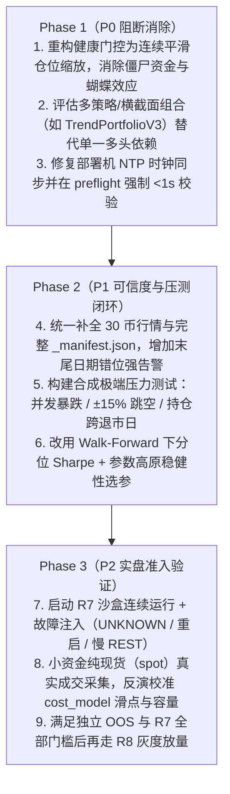

# QuantTradingV1 当前问题综合诊断报告（Report）

> **报告定位**：本报告以**问题为中心**，综合 50 次控制变量回测运行（[summary.json](../../../outputs/reality_gap_experiments/summary.json)，30 币安日线 `2020-01-01 ~ 2026-08-27`，Git `4e913d0a`，Seed `42`，全部 `accounting_ok=True`）与源码/运维/治理审计，系统回答“**当前量化交易系统与实际交易之间到底存在哪些问题、根因是什么、有多严重、该怎么修**”。
> **关联文档**：配套决策清单见 [questions_list.md](./questions_list.md)；完整实验矩阵明细见 [experiments_report.md](./experiments_report.md)。

---

## 一、总体诊断结论（Executive Summary）

**当前核心判断：工程底盘扎实，但系统尚不具备真实资金上线条件（Not Production-Ready）。**

QuantTradingV1 的回测引擎、会计恒等式校验、无前视防线、订单状态机与故障安全机制已达到较高工程水准；但实证回测与代码审计同时暴露出 **12 项明确问题（5 项 P0 阻断级、5 项 P1 高风险、2 项 P2 中风险）**，集中体现在三大矛盾：

1. **策略盈利能力脆弱**：全样本微薄收益高度依赖 `2020–2021` 单边牛市与前 10 笔大赢单，最近 3.6 年（`2023–2026`）整体滞涨转亏，且样本内选参在样本外呈强烈负相关。
2. **风控设计过犹不及且产生混沌分岔**：`StrategyHealthMachine` 长期把仓位锁死在 `0.10x`（平均敞口仅 `1.85%`），一方面把收益压成“僵尸资金”，另一方面导致微小成本/成交扰动触发 **10.7 倍收益落差** 与容量曲线反常跳变，并让下游风控模块失去压力验证。
3. **实盘校准与运维闭环缺失**：合格真实成交样本为 **0**，主机曾出现 **31 秒时钟漂移**，`R7` 沙盒连续运行与 `R8` 灰度准入尚未通过，所有策略均停留在非准入态（`paused_revalidation` / `paused_redesign`）。

### 五大维度健康度总览

| 评估维度 | 当前评级 | P0 | P1 | P2 | 一句话现状 |
| --- | --- | :-: | :-: | :-: | --- |
| **1. 策略 Alpha 与稳健性** | 🔴 高危（未达准入） | 1 | 2 | 0 | 单边牛市依赖、近 3.6 年衰退、Top-10 占 111% 利润、IS/OOS 排名反转 |
| **2. 风控与仓位控制** | 🔴 高危（过度锁死） | 2 | 1 | 0 | 策略健康门控造成 98% 资金闲置、离散阈值引发蝴蝶效应、下游风控零触发 |
| **3. 执行撮合与成本容量** | 🟠 中高危（未校准） | 1 | 1 | 1 | 滑点为佣金 2.64 倍且 0 真实成交校准；ATR 止损反噬；延迟持续损益 |
| **4. 数据与回测完整性** | 🟠 中高危（有错配） | 0 | 1 | 1 | `BTC/ETH` 与 28 币起止不齐虚增 +21.76% 收益；退市/借币约束未经压测 |
| **5. 实盘运维与治理准入** | 🔴 高危（未放行） | 1 | 0 | 0 | 无 `admitted` 策略、主机 31s 时钟偏移历史记录、`UNKNOWN`/补帧未做压测 |

---

## 二、当前存在的问题全量清单（ISS-01 ~ ISS-12）

### 维度一：策略 Alpha 与稳健性

#### `ISS-01` [P0] 单一多头策略跨周期失衡、近 3.6 年 Alpha 衰退且极端依赖少数大赢单
- **实证数据**：
  - 跨周期拆窗：`2020–2021` 牛市 `+14.31%`（Sharpe `1.22`）→ `2022` 熊市 **`-5.50%`**（6 笔全亏，0% 胜率）→ `2023–2024` 震荡市 `+1.68%`（最大回撤 `-11.31%`）→ `2025–2026` 近期 **`-3.49%`**（PF `0.25`）。
  - 盈利集中度：基线 139 笔往返交易净利 `1,908.92 USDT`，其中 Top-1 占 `40.4%`、Top-5 占 `81.0%`、**Top-10 占 `111.0%`**（剔除前 10 笔即亏损 `-210.00 USDT`）；`2023–2024` 震荡期 Top-3 占比高达 **`367.5%`**。
  - 官方历史基线（[unified_roadmap.md](../../../docs/unified_roadmap.md)）：`final20` 收益 `-5.436%`，事件组 PF `0.468`，研究结论为 `fail`。
- **根因**：[params.yaml](../../../config/params.yaml) 仅 `TREND_UP` 路由至 `TrendBreakout`，其余三大状态全部路由至 `Cash`，缺乏熊市/震荡市收益来源与跨资产分散度。
- **实盘后果**：高概率长期横盘磨损；一旦因交易所维护、限流或订单阻塞错过年度头 3–5 笔行情，全年收益立即转负。

#### `ISS-02` [P1] 样本内选参严重过拟合，IS/OOS 排名呈强烈负相关
- **实证数据**：9 组 `(entry_window, exit_window)` 在 `IS (2020-01~2023-06)` 与 31 天 Purge 后的 `OOS (2023-08~2026-08)` 中，收益率 **Spearman 秩相关系数 $\rho = -0.683$**。IS 冠军 `(15, 5)` 赚 `+78.75%`（Sharpe `1.35`），OOS 暴跌 88% 至 `+9.59%`（Sharpe `0.51`）；IS 亚军 `(20, 5)` 从 `+70.21%` 跌至 `+9.06%`。
- **根因**：`exit_window=5` 在 IS 期间碰巧避开了健康门控早期锁死分支，获取了高杠杆红利，而非具备稳健结构性优势。
- **实盘后果**：按历史最优回测选参上线，实盘大概率遭遇断崖式回撤。

#### `ISS-03` [P1] 策略退出高度受控于 Regime 状态切换，策略逻辑与状态机耦合过重
- **实证数据**：锚点 139 笔平仓中，Donchian 自身出场（`Low10`）62 笔（44.6%），而 **Regime 切换强制出场占 62 笔（`VOLATILE`: 35、`SIDEWAYS`: 27，合计 44.6%）**，保护止损占 15 笔（10.8%）。
- **根因**：`TrendBreakout` 允许状态仅限 `TREND_UP`，一旦 ADX/均线/ATR% 抖动即触发全仓退出。
- **实盘后果**：状态机指标微小噪声会引发频繁换手与踏空，策略自身出场规则的控制权被稀释。

---

### 维度二：风控与仓位控制

#### `ISS-04` [P0] 策略健康门控导致“僵尸资金”，平均敞口仅 `1.85%`
- **实证数据**：
  - 锚点基线 6.6 年 CAGR 仅 **`+2.66%`**（总收益 `+19.09%`），平均总敞口仅 **`1.85%`**，持仓天数占比 `32.7%`，超过 **98% 资金长期闲置**。
  - `StrategyHealthMachine` 拦截了 **`54.6%`**（167/306）的原始突破信号，累计冷却 **`904` 天（37.2% 时间）**。从 `2020-05-26` 触发连亏 3 组冷却后，6 年内反复在 `cooldown (0x) ↔ probation (0.10x)` 死循环 **21 次**，再未恢复 `1.0x` 仓位。
  - 剥离健康门控后（`E4_no_health_gate`），收益跃升至 **`+73.23%`**（CAGR `+8.61%`，Sharpe `0.645 → 0.940`，MDD `-15.24%`）；同时剥离回撤熔断的裸策略（`E4_raw_no_breaker_no_health`）达 **`+266.57%`**（MDD `-31.48%`）。
- **根因**：`unified_recovery` 晋升门槛（从 `0.10x` 起步，每级需 ≥30 天 + ≥5 组 + ≥3 币种 + 总 R>0 + 扣最佳组仍 >0，失败即打回 30/90 天冷却）在低频趋势策略下近乎不可达。
- **实盘后果**：资金效率远低于无风险国债，且策略长期处于“假运行、真休眠”状态。

#### `ISS-05` [P0] 离散硬阈值状态机造成剧烈“路径分岔（蝴蝶效应）”
- **实证数据**：
  - **成本分岔（E1）**：从 `0x` 成本（`+35.08%`, 113 笔）到 `1x` 成本（`+19.09%`, 139 笔），仅 `148.76 USDT` 的真实费用造成 **`1,598.93 USDT` 的净收益落差（10.7 倍放大）**。
  - **容量分岔（E3）**：资金从 `10M` 增至 `50M USDT` 时，尽管触发 `92` 次部分成交、`787` 笔成交腿与 **`191,073 USDT` 冲击成本**，收益率却反常从 `+19.04%` 飙升至 **`+76.44%`**（因分批成交偶然改变退出归属，绕过健康门控锁死）。
- **根因**：连亏计数与绝对回撤线的阶跃式开关（`1.0x → 0.0x → 0.10x`）使系统成为高度非连续动力系统。
- **实盘后果**：实盘几 bps 的随机滑点、一次 API 抖动或部分成交即可将账户推入完全不同的状态分支，回测对实盘失去预测意义。

#### `ISS-06` [P1] 上游限流掩盖下游风控，多道防线在常规回测中处于“零触发未验”状态
- **实证数据**：
  - 默认基线下，`spot_margin` 杠杆、`portfolio_risk` 相关性簇限额、`candidate_scoring`、`entry_risk`（`GapRiskResize`）全部被上游 `0.10x` 压制，5 组消融对照结果完全一致（均为 `+19.09%`）。
  - 即使关闭健康门控（`E4b`），`drawdown_budget` 立刻执行 `142` 次减仓并拒绝 `210/339`（61.9%）个候选信号，导致相关性簇限额仍 339/339 全部通过、`GapRiskResize` 仍 128/128 零触发（同时暴露关闭 `candidate_scoring` 退回字母序会损失 `-7.77%` 收益）。
  - 此外，开启 `allocation.capital`（智能配资）反而使回撤翻倍（`-4.84% → -10.56%`）、Sharpe 下降（`0.645 → 0.552`）。
- **实盘后果**：误以为多层风控已通过历史验证，实则一旦上游参数放宽或遭遇跳空/并发崩盘，未经压测的下游模块可能暴露边界缺陷。

---

### 维度三：执行撮合、滑点与资金容量

#### `ISS-07` [P0] 滑点主导交易摩擦且真实执行成本校准样本为 0
- **实证数据**：
  - 锚点 1x 总成本 `148.76 USDT` 中，滑点占 **`107.90 USDT`（72.5%）**，是手续费（`40.86 USDT`）的 **2.64 倍**；3x 成本下系统终态直接被压入 `0.00x` 冷却锁死。
  - [paper_remaining_tasks_20261004.md](../../../docs/research/paper_remaining_tasks_20261004.md) 记录：现有 305 条记录均为未提交拒单，**合格真实成交为 0 笔**，滑点、价差与冲击系数全为经验假设。
- **实盘后果**：突破策略天然在流动性稀薄、追单拥挤的瞬间市价吃单，实盘真实滑点可能远超 5 bps 假设。

#### `ISS-08` [P1] 止损机制对盘中噪声极度敏感：收盘止损虚高，ATR 追踪止损严重反噬
- **实证数据**：
  - 旧收盘止损（`E2_legacy_close_stop`）较真实交易所盘中常驻止损虚增 `+1.77%` 收益与 `+0.29` PF。
  - 启用 `ATR 初始+追踪止损`（`E2_atr_hybrid_trailing_stop`）后，**159 / 176（90.3%）笔仓位被盘中插针扫损出局**，策略自身 Donchian 退出缩水至 7 笔，最大回撤几乎翻倍（`-4.84% → -8.67%`），Sharpe 暴跌 40%（`0.645 → 0.388`）。
- **实盘后果**：盲目引入紧止损或追踪止损在加密高插针市场会产生“反复止损磨损”。

#### `ISS-09` [P2] 执行延迟持续侵蚀收益，且真实全仓容量拐点被低敞口掩盖
- **实证数据**：
  - [delayed_execution.py](../../../backtest/delayed_execution.py) 回放 338 笔真实决策：延迟 `+1 天` 净收益从 `+23.87%` 降至 `+22.60%`（`-1.26%`），延迟 `+2 天` 降至 `+21.88%`（`-1.98%`）。
  - 仅 1.85% 平均敞口下 `10M USDT` 已触及 5% 参与率上限；若恢复 1.0x 正常风险，中小币种真实容量拐点预计下移至 **1M–2M USDT**。

---

### 维度四：数据质量与回测完整性

#### `ISS-10` [P1] 本地行情覆盖起止严重错配，导致全样本回测虚增 `+21.76%` 收益
- **实证数据**：
  - `data/binance/1d/` 中 `BTC_USDT.csv` 与 `ETH_USDT.csv` 为 `2020-01-01 ~ 2026-09-19`，而其余 28 币起于 `2017–2023` 且止于 **`2026-08-27`**（且 `_manifest.json` 仅记录 BTC/ETH）。
  - 直接跑全区间（`E5_raw_2017_2026_coverage_trap`），收益从 `+19.09%` 虚高至 **`+40.85%`（PF `3.68`）**——因 2017–2019 缺失 BTC/ETH 仅交易幸存山寨币，尾部 23 天 28 币估值停滞。
  - 若误用 `intersection` 对齐，区间被 `TIA` 与 `MATIC` 双向截断为 `399` 根 K 线（丢弃 `83.6%` 历史），仅剩 22 笔交易，统计全部失效。
- **实盘/研究后果**：污染历史业绩评估，误导策略准入裁决。

#### `ISS-11` [P2] 退市强平与保证金借币约束在历史样本中缺乏真实压力验证
- **实证数据**：`MATIC-USDT` 末次平仓在 `2023-11-22`（早于 `2025-03-25` 退市日），使 `PIT` 与 `Static` 结果完全一致；配置中 `borrow_availability_required: false`、`default_borrow_limit_qty: 1e12` 且无历史资金费率/借币可得性证据。
- **实盘后果**：做空或持仓遇退市时，可能遭遇无币可借、借币利率飙升或强平流动性枯竭。

---

### 维度五：实盘运维与治理准入

#### `ISS-12` [P0] 实盘基础设施与治理准入尚未闭环（时钟偏移、故障恢复、零连续运行证据）
- **核心事实**：
  1. **治理封锁**：[params.yaml](../../../config/params.yaml) 中 `TrendBreakout=paused_revalidation`，`TrendBreakdown/RangeMeanReversion=paused_redesign`，`VolatilityReversion=isolated_research`，当前 **0 个策略处于 `admitted` 态**。
  2. **时钟漂移事故**：采集主机 Windows `W32Time` 曾处于停止状态，导致本机时间落后币安服务器 **`30.98–31.10 秒`**，548 条盘口深度快照全部判废。
  3. **运维故障风险**：实盘存在 `UNKNOWN` 订单挂起阻断新开仓、崩溃重启补帧（[catchup.py](../../../live_trading/catchup.py)）只推状态不补单、单线程保护单调度受阻塞调用延迟等现实风险，且 `R7` 连续运行与 `R8` 小额灰度证据均为零。

---

## 三、分阶段整改建议路线图

| 阶段 | 对应关闭问题 | 明确验收标准（Exit Criteria） |
| --- | --- | --- |
| **Phase 1（优先）** | `ISS-04`, `ISS-05`, `ISS-01`, `ISS-12`（时钟） | 1. 成本/容量曲线恢复单调平滑，平均敞口回归合理区间； 2. 跨 `2022` 熊市与 `2023–2026` 近期不再系统性失效，剔除 Top-10 后 PF > 1.0； 3. 主机时钟误差 `< 1.0s` 纳入启动硬门禁。 |
| **Phase 2** | `ISS-02`, `ISS-03`, `ISS-06`, `ISS-08`, `ISS-10` | 1. 30 币数据集起止完全对齐并写入 `_manifest.json`； 2. 相关性簇限额、`GapRiskResize`、退市强平在合成极端测试中 100% 触发并验证通过； 3. Walk-Forward OOS 不再出现 IS/OOS 负相关反转。 |
| **Phase 3** | `ISS-07`, `ISS-09`, `ISS-11`, `ISS-12`（R7/R8） | 1. 完成 R7 沙盒连续运行与故障注入演练； 2. 取得 ≥10 训练日 + ≥5 测试日合格真实成交成本证据并完成 `cost_model` 校准； 3. 仅在独立前瞻窗口验收通过后，从纯现货小额单标的开始灰度。 |
