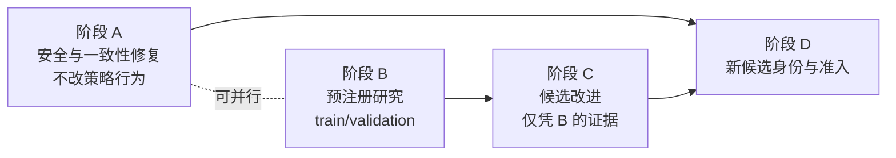

# 策略问题整改 Roadmap 与开发计划（2026-11-10）

> 适用范围：`TrendBreakout` 及其共用的 `strategies/`、`router/`、`core/trading/state.py`、
> `core/analytics/strategy_health.py`、实盘取数路径。
> 上级文档：[统一 Roadmap v3.0](unified_roadmap.md) → [开发计划](development_plan.md)。本文件不改变
> R0–R8 阶段定义，只把 2026-11-10 代码审查发现的问题排进现有框架。
> 当前正式策略状态仍为 **paused_revalidation**。本文件的任何一项完成，都不构成真实资金放行。

## 1. 依据：2026-11-10 发现的问题

| ID | 问题 | 位置 | 证据 | 是否改变候选策略行为 |
| --- | --- | --- | --- | --- |
| F-01 | 状态离开 TREND_UP 即平仓，可能截断趋势盈利单 | `strategies/trend_breakout.py:592`、`strategies/base.py:51` | 消融已做：验证段 +2.1% 对 +0.03%，最终段 −6.7% 对 −5.0%，方向不一致 → **结论：维持现状，关闭** | — |
| F-02 | 入场确认层数多（ADX+均线+5 根稳定+2 根冷却+20 日突破+OBV），信号少且晚 | 状态机、路由、策略 | 每币约 6 年 8–14 笔；健康与准入统计效力弱 | 是 |
| F-03 | 实盘只取 100 根 K 线：V2/V3 需要 ≥121 根，实盘永不入场；状态机在 100 根窗口与回测不一致 | `live_trading/engine.py:224`、`core/market/market_data.py:348` | BTC 100 根窗口 0.7%（16/2354）bar 状态不一致，200 根为 0 | 实盘行为是（向回测对齐） |
| F-04 | `Strategy.on_bar` 只被测试调用，与生产路径 `submit_entry_candidate` 已分叉 | `strategies/base.py:456-656` | 缺参考价、相关性预算；`stop_loss=None` 会抛错 | 否（死代码） |
| F-05 | 持仓到期退出无挂单锁，每根 bar 重复提交全仓卖单；实盘只校验单张不超仓，不累计在途卖单 | `router/router.py:89-97`、`live_trading/execution_adapter.py:96` | 回测被 NO_POSITION 掩盖；spot_margin 实盘可能超卖 | 回测否；实盘是（更安全） |
| F-06 | 到期平仓后若仍在 20 日高点上方，下一根立即买回 | `router/router.py` | 设计推演，未量化 | 是 |
| F-07 | 健康冷却对正偏态趋势策略区分度弱 | `core/analytics/strategy_health.py:430-507` | 模拟：+0.2R 策略平均仓位 0.22，−0.3R 为 0.12；实盘满仓时间 5–9% | 是 |
| F-08 | `check_health` 每次调用都写盘 | `strategies/trend_breakout.py:231` | 每标的每 bar 一次持久化 | 否 |
| F-09 | 参数重复/写死：评分用 `ADX_14`；`candidate_scoring.adx_threshold` 与 `state.adx_threshold` 两份 | `strategies/trend_breakout.py:357`、`config/params.yaml` | 改一处漏一处的风险 | 默认配置下否 |
| F-10 | 追踪止损漏掉成交当根最高价；`entry_price` 记参考价而非成交价 | `strategies/trend_breakout.py:302-340` | 追踪/保本止损默认关闭 | 默认配置下否 |
| F-11 | V3 每 bar 全量重算 O(n²)；入场止损与出场口径不一致 | `strategies/trend_portfolio_v3.py` | 代码审查 | 是（仅 V3 研究） |
| F-12 | 已暂停策略的遗留问题（Range 冷却写死 24 根、Volatility 的 "atr" 不是 ATR、配对 z-score 样本内） | `strategies/mean_reversion.py:99`、`strategies/volatility.py:44`、`strategies/statistical_arbitrage.py` | 代码审查 | 仅在重新设计时处理 |

## 2. 必须遵守的约束

1. **前瞻观察窗不能被打乱。** 现候选身份的观察窗为 **[2026-10-21, 2027-04-19)**，最早成熟日
   **2027-05-09**（见 [统一 Roadmap 第 6 节](unified_roadmap.md)）。凡是“改变候选策略行为”的修改，
   必须先按原协议登记影响，再建立**新身份和新观察窗**，不得复用旧哈希声称是同一候选。
2. **选参只用 train60 / validation20。** final20 是最终保留段，只做单次独立评价；它已被
   2026-10-02 和 2026-11-10 两次回顾性研究看过，只能当回顾性证据。
3. **先预注册，再跑。** 新研究先在 `docs/research/current_strategy_experiment_registry.jsonl`
   登记，并写协议文档，再运行。
4. **一个 PR 一批，一个提交一类改动。** CHANGELOG/路线图状态在批次最后一个提交统一更新。
5. **改代码不等于放行。** 准入仍走 SR5 → R7（≥56 个连续自然日）→ R8。

## 3. Roadmap

### 阶段 A：安全与一致性修复（不改变候选策略的回测行为）

> **状态：已完成（批次 1，2026-11-10）。** 见第 7 节。

目标：堵住实盘风险和代码分叉。完成后回测基线必须**逐位不变**（固定回归一致）。

- A1 持仓到期退出加挂单锁；实盘减仓校验改为“在途减仓总量 ≤ 持仓”（F-05）
- A2 删除或收敛 `Strategy.on_bar`，测试改走生产路径（F-04）
- A3 启动预检：实盘取数长度 ≥ 所有已路由策略与状态机所需历史，否则拒绝启动（F-03 的护栏部分）
- A4 健康状态只在状态变化时写盘（F-08）
- A5 合并重复参数：评分 ADX 周期/阈值改为引用 `state` 配置（F-09；默认值相同，行为不变）

退出条件：全量测试通过；固定基线回归逐位一致；A1 有超卖场景的回归测试；A3 有取数不足时拒绝启动的测试。

### 阶段 B：预注册研究（只用 train60 / validation20）

目标：用证据回答“改哪里”，不按历史最佳收益挑方案。

| ID | 研究 | 状态 |
| --- | --- | --- |
| B0 | regime 退出消融（F-01） | **已完成**：方向不一致，维持现状 |
| B1 | SR1-HEALTH-006 健康冷却政策（F-07） | **已完成**（[协议](research/health_policy_study_20261110.md)、[结果](research/health_policy_study_20261110_results.md)）。train60 选择：放宽连亏门槛（4 次 +53.1%/回撤 15.0%，5 次 +30.9%/8.8%）都不如现行规则（+64.8%/9.1%），被否决；去掉“去掉最佳仍为正”规则的 h3 入选（+133.5%/8.0%，去掉前 5 笔仍 6520 对 2842），但增益集中在 2020–2021 年，年度胜出刚好 3/6。validation20 确认：与基线**逐位相同**。该段每次试用期都因总 R ≤ 0 失败，从未走到被去掉的规则，所以“确认通过”只是形式上成立，**没有提供独立证据**。结论：h3 只能作为弱候选，需要 B5 的统计效力分析和新的未见样本再判断 |
| B2 | SR-DATA-001 实盘取数长度对状态与信号的影响（F-03） | **已完成**（[结果](research/live_window_study_20261110_results.md)）。100 根已收盘窗口：1.15% 的 bar 状态与全历史不同（60 币中 59 个），多出 28 个回测没有的入场候选；200、400 根完全一致。按规则选 200 根，C2 把实盘 `lookback_days` 定为 201 |
| B3 | 入场延迟与信号稀疏（F-02） | 待登记：稳定期、路由冷却、OBV 各自的边际贡献；可复用已登记的 SR-ALPHA-002/003 |
| B4 | SR-EXIT-001 到期平仓后立即买回（F-06） | **已完成**（[结果](research/time_exit_rebuy_study_20261110_results.md)）。两段到期平仓均为 0 次（最长持仓 93/56 天，上限 365）→ F-06 关闭，维持现状 |
| B5 | SR1-HEALTH-007 健康机制统计效力（F-07 的补充） | **已完成**（[结果](research/health_power_study_20261110_results.md)）。+0.2R 策略平均仓位 0.15、−0.3R 为 0.10，+0.2R 第一年触发冷却 98.7% → 区分能力不合格；h3 只提高 0.05（门槛 0.10）→ 不进入 C1，阶段 C 不改健康政策 |

退出条件：每项研究都有登记、协议、冻结的 registration.json 和按事先规则写出的结论（包括“维持现状”）。

### 阶段 C：候选改进（只有阶段 B 给出正面证据才做）

- C1 把 B 中通过确认的改动合成**一个**新候选，一次只改一个维度
- C2 实盘取数长度调整到 B2 的结论值（F-03 的行为部分）
- C3 追踪/保本止损的输入修正（F-10），只在这两项将要启用时做
- C4 V3 性能与口径修正（F-11），只在 V3 将进入实盘候选时做

如果阶段 B 全部是“维持现状”，阶段 C 为空。这是合法结果，不是失败。

### 阶段 D：新候选身份与准入（沿用现有流程）

D1 登记新候选身份与新前瞻观察窗 → D2 SR5 单次保留段评价 → D3 R7 连续运行（≥56 天、≥2 种市场状态）→ D4 R8 小额灰度（人工批准）。

## 4. 开发计划

### 4.1 批次

| 批次 | 内容 | 依赖 | 交付 |
| --- | --- | --- | --- |
| 批次 1 | A1–A5 | 无 | 一个 PR，5 个提交；最后一个提交更新 CHANGELOG |
| 批次 2 | B1 收尾 + B2、B4、B5 登记与运行 | B1 正在运行 | 研究报告 + registry 状态更新；不改策略代码 |
| 批次 3 | B3 | 批次 2 | 同上 |
| 批次 4 | C1–C4 中有证据支持的项 | 批次 2、3 的结论 | 新候选身份 + 一个 PR |
| 批次 5 | D1–D4 | 批次 4 | 按现有 SR5/R7/R8 流程 |

批次 1 与批次 2 改动的文件互不重叠，可以并行。批次 4 必须等研究结论。

### 4.2 任务明细

| 任务 | 改动文件 | 验收 | 批次 |
| --- | --- | --- | --- |
| A1 到期退出加锁 | `router/router.py`、`live_trading/execution_adapter.py` | 新测试：到期退出未成交时下一根不重复下单；两张在途卖单合计超仓时第二张被拒 | 1 |
| A2 收敛 `on_bar` | `strategies/base.py`、引用它的 3 处测试 | 生产代码无入场逻辑重复；原测试改走 `collect_candidate → submit_entry_candidate` 并通过 | 1 |
| A3 取数长度预检 | `live_trading/engine.py`、各策略新增 `required_history` | 新测试：路由 V3 且取数 100 根时启动失败并给出原因 | 1 |
| A4 健康写盘频率 | `strategies/trend_breakout.py` | 新测试：状态不变时不写盘；重启恢复测试仍通过 | 1 |
| A5 参数去重 | `strategies/trend_breakout.py`、`composition/factory.py`、`config/params.yaml` | 默认配置下固定回归逐位一致 | 1 |
| B1 收尾 | `reports/health_policy_study_20261110/` | `selection.json` 按规则产出；若有选中方案，再跑一次 validation20 确认 | 2 |
| B2 取数长度研究 | 新脚本 + 协议文档 | 预注册；输出各窗口长度的状态/信号/成交差异表 | 2 |
| B4 立即买回统计 | 新分析脚本 | 次数、往返成本、对收益的影响 | 2 |
| B5 统计效力 | 新脚本 + 协议文档 | 各期望值下的冷却时间占比与误触发率表 | 2 |
| B3 入场延迟 | 复用 SR-ALPHA-002/003 | 每个组件的边际贡献（train/validation） | 3 |

### 4.3 每个任务的流程

1. 在任务登记表或研究 registry 里登记；研究先写协议。
2. 开发与测试；本地运行 `python scripts/dev.py check`。
3. 阶段 A 的任务：确认固定基线回归逐位不变。
4. 改变行为的任务：先写候选身份影响说明。
5. 批次最后一个提交更新 CHANGELOG 与本文件的状态列；由仓库所有者合并。

## 5. 时间安排（参考，不是承诺）

| 时间 | 事项 |
| --- | --- |
| 2026-11 中旬 | 批次 1 完成；B1 出结论 |
| 2026-11 下旬–12 月 | 批次 2、3 |
| 2027-01 | 根据研究结论决定批次 4 是否有内容 |
| 2027-05-09 之后 | 现候选前瞻观察成熟；若有新候选，按其自己的观察窗另计 |

## 6. 风险与不做的事

- **不按历史最佳收益选方案。** 例如关掉健康机制在 final20 上 +36%，但去掉前 5 笔盈利单后不及基线，而且那一段已经被看过，不能作为依据。
- **不为了提高交易频率而放宽风控。** 阶段 B 的结论允许是“维持现状”。
- **不处理已暂停策略（F-12）**，除非它们进入重新设计（T-4.5/4.6/4.7）。
- 风险：每段只有几十笔交易，研究结论噪声大。所以预注册规则里有“去掉前 5 笔”和“年度胜出”两道门槛，阶段 C 一次只改一个维度。

## 7. 状态记录

| 日期 | 事项 |
| --- | --- |
| 2026-11-10 | 建立本文件；B0 完成（维持现状）；B1 完成：h3 在 train60 入选，validation20 与基线相同（确认无信息量），列为弱候选，不改配置 |
| 2026-11-10 | 阶段 A（批次 1）完成：A1 到期退出挂单锁 + 实盘减仓累计校验（不计常驻保护止损）；A2 删除 `Strategy.on_bar`，测试改走生产路径；A3 实盘启动预检（`live_trading/history_preflight.py`，V2/V3 需 121 根，状态机给出定义性下限，消除路径漂移所需长度留给 B2）；A4 健康状态仅在检查点变化时写盘；A5 评分 ADX 周期/阈值改读 `state`，`candidate_scoring` 的重复项删除（不一致时拒绝启动）。固定基线回归逐位一致；冻结范围身份哈希变化，不构成新候选、未重新登记。 |
| 2026-11-10 | 批次 2 完成：B1 补交协议/脚本/结果；B4 关闭 F-06（维持现状）；B2 选定 200 根已收盘窗口（C2 输入：`lookback_days = 201`）；B5 判定健康机制区分能力不合格、h3 不推进（阶段 C 不改健康政策）。剩余：批次 3（B3），之后批次 4 只剩 C2 一项有证据支持 |
